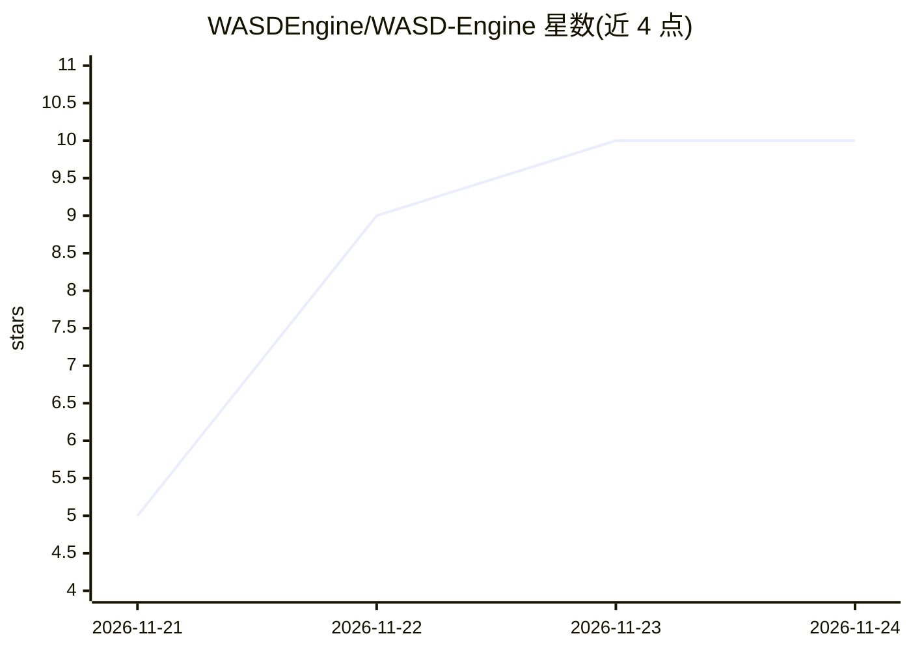

# WASDEngine/WASD-Engine

⭐ 10 · TypeScript · GPL-3.0 · 推送 2026-11-20 · [GitHub](https://github.com/WASDEngine/WASD-Engine) · [官网](https://wasdengine.com) · 组织维护

**给游戏开发者的 AI 代理开发工作台：整合 Godot/Blender 等工具**

将 Godot 4、Blender、GIMP、SuperCollider 打包为单一开源 agent harness，代理可完成游戏从规划、编码、建模、贴图、音频到自测的完整流程。桌面应用（macOS/Windows）内置这些工具，也可从源码运行（需 Node.js 24.9+ 与 pnpm）。支持通过 MCP 接入 Claude Code、Codex 等外部代理；模型调用经其账户网关计费，设有 Free/Pro/Max 订阅档位，新账户需先加入 waitlist。

## 筛选速览

| 维度 | 判定 | 备注 |
|---|---|---|
| AI 角色 | `ai-ecosystem` | LLM/agent 周边工具 |
| 许可风险 | `viral` | GPL-3.0 |
| 部署形态 | `desktop` | 安装包/桌面程序 |
| 模型依赖 | locked-api |  |
| 硬件要求 | — | 无带数字的原话,不猜 |
| 安装摩擦 | `low` | 无编译、无系统依赖或容器化 |
| 成熟度 | — | 结构信号不足 |

## 能力要点

- 捆绑 Godot 4、Blender、GIMP、SuperCollider，代理可全流程开发游戏
- 内置 patched LibGodot 运行时，代理可运行游戏、读取截图/日志/报错进行自测
- 通过本地 MCP server 向 Claude Code、Codex 等已有代理开放同一套游戏工具
- 内置 Poly Haven CC0 资产检索工具，支持多语言按描述搜索并校验文件校验和

## 适用场景

- 用对话描述游戏需求，让代理完成从建模到音效的开发
- 导出 Web 游戏、Mac/Windows 安装包、Android/iPhone 项目
- 为游戏添加最多 8 人联机并由服务端托管
- 把已有订阅的编码代理接入游戏开发工具链

## 场景标签

`编码 Agent` `AI 助手` · 领域:编码与开发

## 证据(README 行号)

> L10:  into a single open-source agent harness.
> L24: WASD Engine bundles everything you need to build high-polish games in a single agent harness, so your agents can bu
> L92: Connect your existing subscription to WASD Engine for free using MCP. WASD Engine runs an MCP server on your comput

## 星数曲线

2026-11-21 5 → 2026-11-24 10（+5）

---
*卡片 v1 · prompt 1.4 · 生成 2026-11-21 · 置信度 high · 依据 README sha `20efcfa4941e` · [字段定义](../../DATASET.md)*
