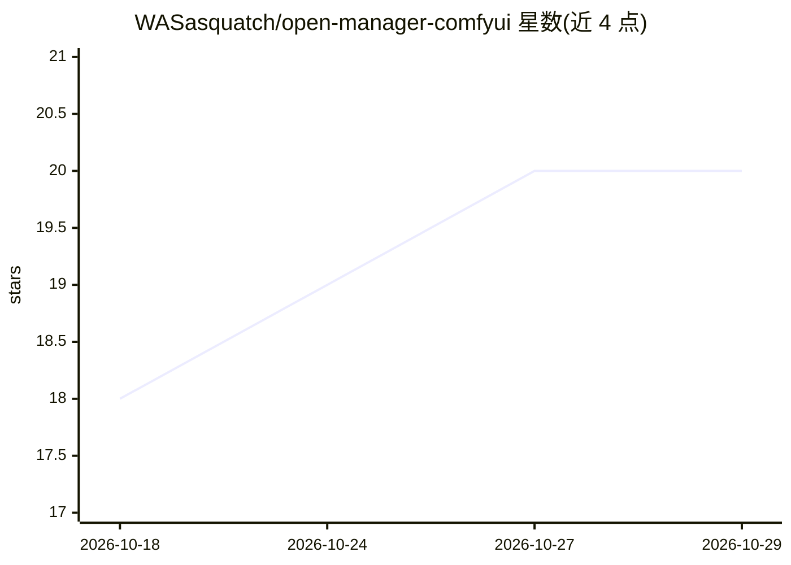

# WASasquatch/open-manager-comfyui

⭐ 20 · JavaScript · MIT · 推送 2026-10-28 · [GitHub](https://github.com/WASasquatch/open-manager-comfyui) · 个人维护

**ComfyUI 的替代包管理器：管理节点包、模型与文件**

面向 ComfyUI 用户的包管理工具：以 manager 方式（pip 安装并加 --enable-manager 启动参数，替换 ComfyUI-Manager）或 custom node 方式（git clone）安装。功能包括从 Comfy Registry 或 GitHub 浏览与安装节点包（安装前展示依赖变更、硬件适配等检查结果）、模型下载管理、磁盘模型库、CPU/RAM/VRAM 资源监控与 Desktop Mode 文件管理。支持通过环境变量控制安装、GitHub、下载等开关，可选配置 HF_TOKEN、GITHUB_TOKEN、VirusTotal 等密钥。

## 筛选速览

| 维度 | 判定 | 备注 |
|---|---|---|
| AI 角色 | `ai-ecosystem` | LLM/agent 周边工具 |
| 许可风险 | `permissive` | MIT |
| 部署形态 | `desktop` | 安装包/桌面程序 |
| 模型依赖 | — | README 未给出锁定关系 |
| 硬件要求 | — | 无带数字的原话,不猜 |
| 安装摩擦 | `low` | 无编译、无系统依赖或容器化 |
| 成熟度 | — | 结构信号不足 |

## 能力要点

- 可作为 manager 替换 ComfyUI-Manager，或作为 custom node 安装
- 安装节点包前展示检查结果、依赖变更与硬件适配
- 内置 Download Manager、Model Library、Resource Monitor 与 Desktop Mode（均默认或开关控制）
- 环境变量服务器开关控制安装/GitHub/下载/重启等权限

## 适用场景

- 替换 ComfyUI-Manager 统一管理节点包与模型
- 安装前审查节点包内容与依赖变更
- 在 ComfyUI 内监控资源与管理工作区文件

## 场景标签

 · 领域:AI 工作流工具/包管理

## 证据(README 行号)

> L14: ## A manager for the whole ComfyUI workspace, not just its nodes.
> L24: **_Open Manager_** _is not affiliated with ComfyUI-Manager or the Comfy Registry._
> L33: |Installed with|pip, into the Python ComfyUI runs on|`git clone` into `custom_nodes`, or from ComfyUI-Manager or th

## 星数曲线

2026-10-18 18 → 2026-10-29 20（+2）

---
*卡片 v1 · prompt 1.4 · 生成 2026-10-28 · 置信度 high · 依据 README sha `4fad76a9bc76` · [字段定义](../../DATASET.md)*
