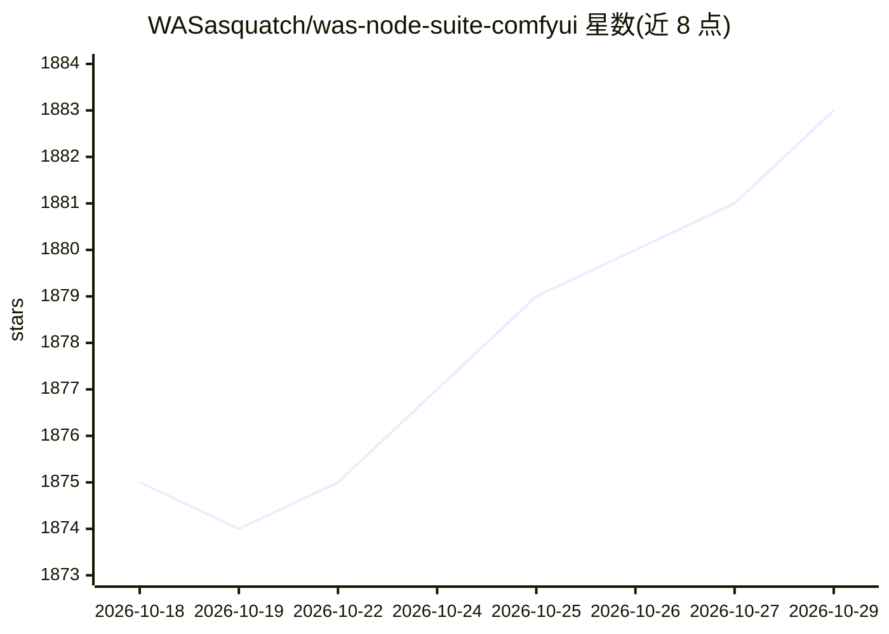

# WASasquatch/was-node-suite-comfyui

⭐ 1,883 · Python · MIT · 推送 2026-10-28 · [GitHub](https://github.com/WASasquatch/was-node-suite-comfyui) · 个人维护

**ComfyUI 节点套件：527 个图像处理与工作流扩展节点**

面向 ComfyUI 用户的节点扩展包（WAS-NS v3），提供 527 个节点，覆盖图像处理、滤镜与色彩、遮罩、图层、文本与提示词、逻辑与流程、数字、latents 与采样、文件与文档导出、动画视频及 Three.js 3D 场景等 48 个类别。安装后不自动 pip 安装任何包、不发起外网请求，第三方文件（three.js、八个人脸级联、Kandinsky 6 网络等 162 个）随仓库分发并各自保留许可证。功能按 config.yaml 的 22 个可选组开关控制，旧 v2 工作流加载时自动迁移。28 个节点已标记废弃并注明替代。

## 筛选速览

| 维度 | 判定 | 备注 |
|---|---|---|
| AI 角色 | `ai-ecosystem` | LLM/agent 周边工具 |
| 许可风险 | `permissive` | MIT |
| 部署形态 | `desktop` | 安装包/桌面程序 |
| 模型依赖 | — | README 未给出锁定关系 |
| 硬件要求 | — | 无带数字的原话,不猜 |
| 安装摩擦 | `low` | 无编译、无系统依赖或容器化 |
| 成熟度 | — | 结构信号不足 |

## 能力要点

- 527 个节点覆盖 48 个类别，包括 43 个 Three.js 场景节点与 28 个文件/文档节点
- 零默认依赖安装、零外网请求，权重下载需显式开启 network 开关
- v2 工作流加载时自动迁移节点与连线，四个退役节点可在缺失对话框中一键替换
- config.yaml 提供 22 个功能组开关与按节点禁用

## 适用场景

- 在 ComfyUI 工作流中做图像滤镜、遮罩、图层与色彩处理
- 构建带逻辑分支与数字/文本处理的复杂生成流程
- 导出 .docx/.odt/.pdf 文档（需启用可选的 document_export 组）
- 生成 Three.js 3D 场景与动画视频节点

## 场景标签

`图像视频处理` `图像生成` · 领域:内容生成

## 证据(README 行号)

> L8: The pack contains **527 nodes for ComfyUI**, across images, filters and colour, masking,
> L16: **ComfyUI Manager**, search for `WAS Node Suite v3` and install. This is the recommended route.

## 星数曲线

2026-10-18 1,875 → 2026-10-29 1,883（+8）

---
*卡片 v1 · prompt 1.4 · 生成 2026-10-21 · 置信度 mid · 依据 README sha `67042bd8fbf0` · [字段定义](../../DATASET.md)*
