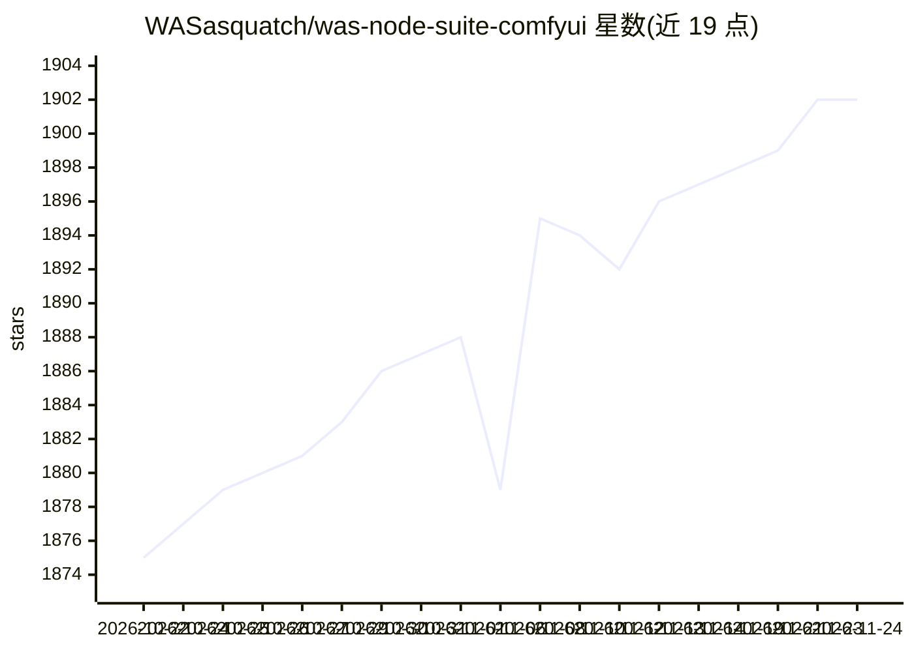

# WASasquatch/was-node-suite-comfyui

⭐ 1,902 · Python · MIT · 推送 2026-11-19 · [GitHub](https://github.com/WASasquatch/was-node-suite-comfyui) · 个人维护

**ComfyUI 的 757 节点图像处理与 Llama-Index 套件**

为 ComfyUI 提供的节点套件，包含 757 个节点，覆盖图像处理、滤镜与色彩、遮罩、文本与提示词、逻辑流程、数值、latent 与采样、文件、动画视频等类别；其中 Llama-Index 节点组把文档加载、向量库、检索、查询与聊天引擎、agent 等接入画布，可索引文本与图像帧并调用已加载的模型或本地/托管服务。套件本体零依赖安装（git clone 即可），四个可选功能组（文档导出、llm、向量库、chroma）需另行安装包；不主动下载，network 默认关闭。

## 筛选速览

| 维度 | 判定 | 备注 |
|---|---|---|
| AI 角色 | `ai-native` | 本体是模型或模型工具 |
| 许可风险 | `permissive` | MIT |
| 部署形态 | `desktop` | 安装包/桌面程序 |
| 模型依赖 | local-ok | 支持本地模型 |
| 硬件要求 | — | 无带数字的原话,不猜 |
| 安装摩擦 | `low` | 无编译、无系统依赖或容器化 |
| 成熟度 | `idea` | |

## 能力要点

- 757 个节点覆盖图像、滤镜、遮罩、文本、逻辑、latent、文件、动画等 75 类
- Llama-Index 节点组：文档加载器、向量库、检索器、chat 引擎与 agent 以节点形式接线
- 本体安装零依赖、零下载、不自行运行 pip，第三方内容随仓库附带
- 人脸检测、渐变映射、背景去除等改在 torch 上运行，不再安装 OpenCV/rembg 等库

## 适用场景

- 在 ComfyUI 画布上组合图像处理、遮罩与滤镜工作流
- 把本地笔记文件夹和图片接入 Llama-Index 节点做检索问答与提示词撰写
- 迁移 v2 旧工作流并在加载时自动替换退役节点

## 场景标签

`图像生成` `图像视频处理` `文档解析` `RAG` · 领域:内容生成

## 证据(README 行号)

> L8: The pack contains **757 nodes for ComfyUI**, across images, filters and colour, masking,
> L12: **Llama-Index in ComfyUI** puts llama-index on the canvas. Models, document loaders, splitters,
> L82: seamless textures, colour matching, levels, palettes, masks and deconvolution all run on torch,

## 星数曲线

2026-10-22 1,875 → 2026-11-24 1,902（+27）

---
*卡片 v1 · prompt 1.4 · 生成 2026-11-23 · 置信度 mid · 依据 README sha `a5f425a9c5ac` · [字段定义](../../DATASET.md)*
