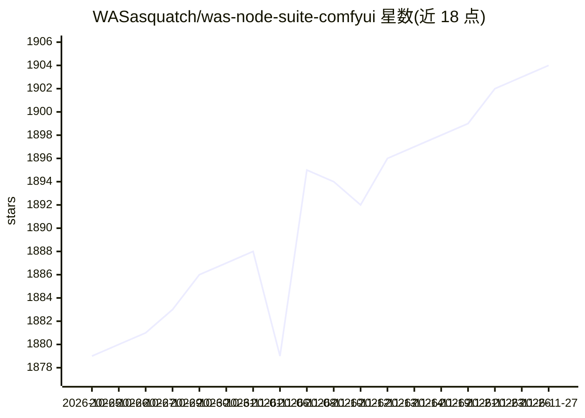

# WASasquatch/was-node-suite-comfyui

⭐ 1,904 · Python · MIT · 推送 2026-11-24 · [GitHub](https://github.com/WASasquatch/was-node-suite-comfyui) · 个人维护

**为 ComfyUI 提供 765 个图像/文本/动画处理节点的扩展包**

面向 ComfyUI 的节点套件，自 2023 年起维护，提供 765 个节点，覆盖图像处理、滤镜与色彩、遮罩、文本与提示词、逻辑流、数值、latent 与采样、文件、动画与视频等 75 个类别。v3 版本将默认依赖从 20 个包降为 0，节点计算改跑在 ComfyUI 自身 torch 设备上；另含可选的 Llama-Index 节点组，把文档加载、向量库、检索、agent 等接到画布上，可读取 GGUF、本地服务器或托管服务。安装方式为克隆到 custom_nodes 目录，要求 ComfyUI 0.14.0+ 与 Python 3.10+。

## 筛选速览

| 维度 | 判定 | 备注 |
|---|---|---|
| AI 角色 | `ai-enhanced` | 去掉 AI 部分产品仍成立 |
| 许可风险 | `permissive` | MIT |
| 部署形态 | `desktop` | 安装包/桌面程序 |
| 模型依赖 | local-ok | 支持本地模型 |
| 硬件要求 | — | 无带数字的原话,不猜 |
| 安装摩擦 | `low` | 无编译、无系统依赖或容器化 |
| 成熟度 | `idea` | |

## 能力要点

- 765 个节点覆盖图像、滤镜、遮罩、文本、逻辑、动画等 75 类
- 核心包零依赖安装，不运行 pip、不发起出站请求
- 可选 Llama-Index 节点组：文档加载、向量库（FAISS/LanceDB/Postgres/Chroma）、agent
- 提供工作流索引与 NODES.md 参考文档

## 适用场景

- 在 ComfyUI 画布上做图像滤镜、遮罩与批量处理
- 把本地笔记与图片文件夹接入 Llama-Index 做检索问答
- 组合节点搭建动画与视频生成工作流
- 从 v2 平滑迁移旧工作流（含节点替换指引）

## 场景标签

`图像视频处理` `视频生成` · 领域:内容生成

## 证据(README 行号)

> L10: The pack contains **765 nodes for ComfyUI**, across images, filters and colour, masking,
> L14: **Llama-Index in ComfyUI** puts llama-index on the canvas. Models, document loaders, splitters,
> L49: Four optional groups want packages and ship off: `document_export`, which lets **Save DOC**

## 星数曲线

2026-10-25 1,879 → 2026-11-27 1,904（+25）

---
*卡片 v1 · prompt 1.4 · 生成 2026-11-26 · 置信度 mid · 依据 README sha `7b4916587544` · [字段定义](../../DATASET.md)*
