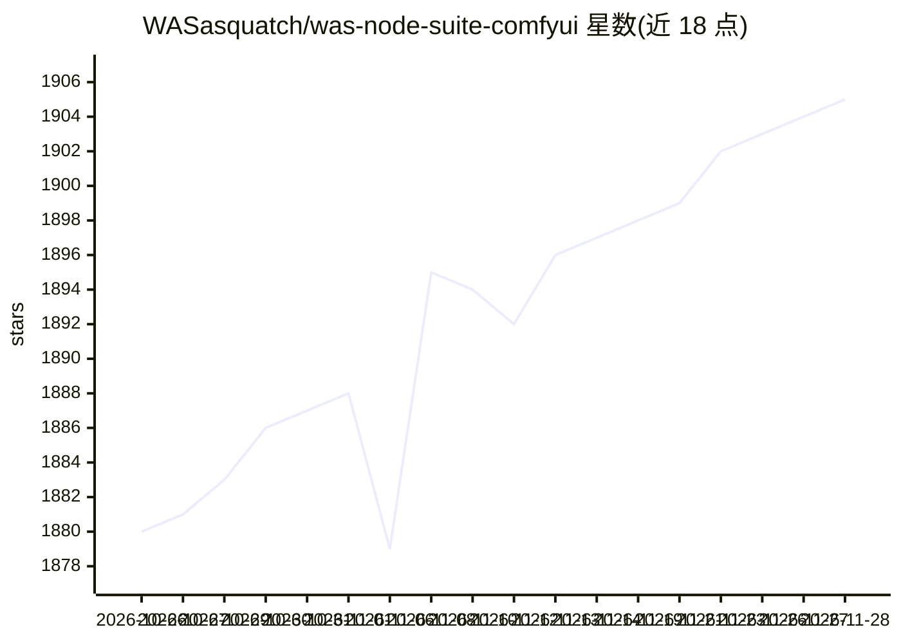

# WASasquatch/was-node-suite-comfyui

⭐ 1,905 · Python · MIT · 推送 2026-11-27 · [GitHub](https://github.com/WASasquatch/was-node-suite-comfyui) · 个人维护

**为 ComfyUI 提供 777 个图像/文本/逻辑/Llama-Index 节点的扩展包**

面向 ComfyUI 的节点套件，自 2023 年维护，提供 777 个节点，覆盖图像处理、滤镜、遮罩、文本与提示词、逻辑与流程、数字、latent 与采样、文件、动画视频及 Three.js 场景。v3 将节点数从 220 扩至 723，默认零依赖安装，多数原有依赖 OpenCV/rembg 等的功能改在 torch 上运行；另含 Llama-Index 节点组，可在画布上接入文档加载器、向量库、检索与 agent，支持 GGUF、Hugging Face 目录与本地服务器（如 Ollama）。需 ComfyUI 0.14.0+ 与 Python 3.10+，通过 git clone 安装，含 28 个被标记为废弃的节点。

## 筛选速览

| 维度 | 判定 | 备注 |
|---|---|---|
| AI 角色 | `ai-ecosystem` | LLM/agent 周边工具 |
| 许可风险 | `permissive` | MIT |
| 部署形态 | `desktop` | 安装包/桌面程序 |
| 模型依赖 | local-ok | 支持本地模型 |
| 硬件要求 | — | 无带数字的原话,不猜 |
| 安装摩擦 | `low` | 无编译、无系统依赖或容器化 |
| 成熟度 | `idea` | |

## 能力要点

- 777 个节点覆盖 76 个类别，含 425 个 v3 新增节点
- Llama-Index 节点组：文档、向量库、检索、agent 以节点形式接入画布
- 默认零 pip 依赖安装，核心功能运行在 ComfyUI 自身设备上的 torch
- 四个可选功能组（document_export/llm/vector_stores/chroma）按需安装

## 适用场景

- 在 ComfyUI 工作流中做图像滤镜、遮罩与图层合成
- 在画布上搭建文档问答与检索流程（Llama-Index 节点组）
- 处理动画、视频帧与 Three.js 场景渲染
- 迁移并修复 v2 旧工作流中的节点替换

## 场景标签

`图像生成` `图像视频处理` `文档问答` · 领域:内容生成

## 证据(README 行号)

> L10: The pack contains **777 nodes for ComfyUI**, across images, filters and colour, masking,
> L14: **Llama-Index in ComfyUI** puts llama-index on the canvas. Models, document loaders, splitters,
> L39: Requires **ComfyUI 0.14.0 or newer** and **Python 3.10+**.

## 星数曲线

2026-10-26 1,880 → 2026-11-28 1,905（+25）

---
*卡片 v1 · prompt 1.4 · 生成 2026-11-28 · 置信度 mid · 依据 README sha `648d19fd1db0` · [字段定义](../../DATASET.md)*
