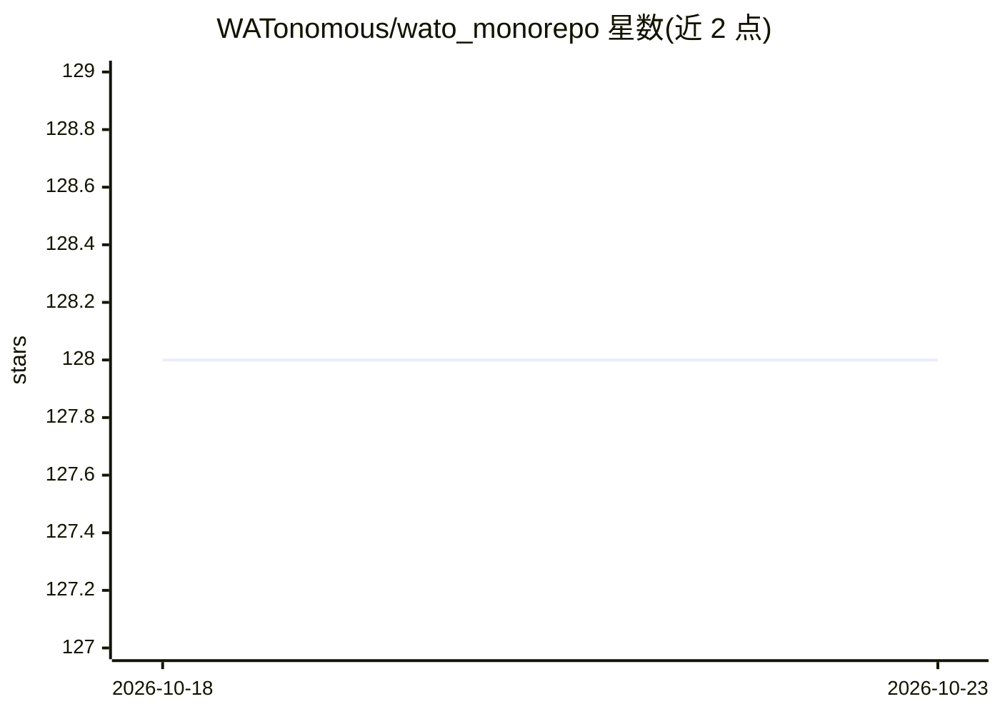

# WATonomous/wato_monorepo

⭐ 128 · C · Apache-2.0 · 推送 2026-10-20 · [GitHub](https://github.com/WATonomous/wato_monorepo) · [官网](https://www.watonomous.ca/) · 组织维护

**WATonomous 自动驾驶软件全栈的 Docker 化 ROS2 单体仓库**

面向 WATonomous 团队自动驾驶赛车项目 EVE 的单体仓库，以 Docker 封装 ROS2 全流程，覆盖传感器与车辆接口、感知（需下载模型权重做推理）、世界建模（需地图与 .osm HD 地图文件）、动作控制、CARLA 仿真与 foxglove/rosbag 基础设施。模型权重、地图与 bag 录制存放于仅团队成员可访问的 Google Drive，支持 Linux Ubuntu>=22.04/WSL/macOS，部分功能可能需要 NVidia GPU。

## 筛选速览

| 维度 | 判定 | 备注 |
|---|---|---|
| AI 角色 | `ai-enhanced` | 去掉 AI 部分产品仍成立 |
| 许可风险 | `permissive` | Apache-2.0 |
| 部署形态 | `None` |  |
| 模型依赖 | — | README 未给出锁定关系 |
| 硬件要求 | — | 无带数字的原话,不猜 |
| 安装摩擦 | `low` | 无编译、无系统依赖或容器化 |
| 成熟度 | — | 结构信号不足 |

## 能力要点

- Docker 封装的 ROS2 自动驾驶全流程模块（感知/世界建模/动作/仿真）
- CARLA 仿真模块与 foxglove bridge/rosbag 数据流基础设施
- 大文件（权重/地图/bag 录制）经 Google Drive 分发，感知与世界建模分别依赖权重与地图

## 适用场景

- 在本地 PC 上复现与开发 WATonomous 自动驾驶软件栈
- 用 CARLA 仿真环境测试感知与规划模块
- 连接实车传感器与车辆硬件进行联调

## 场景标签

 · 领域:自动驾驶/机器人

## 证据(README 行号)

> L20:  - **REQUIRED** by **perception** (model weights for inference)
> L28: `Perception` Launches packages for perception. see docs

## 星数曲线

2026-10-18 128 → 2026-10-23 128（+0）

---
*卡片 v1 · prompt 1.4 · 生成 2026-10-22 · 置信度 mid · 依据 README sha `c603758cec69` · [字段定义](../../DATASET.md)*
