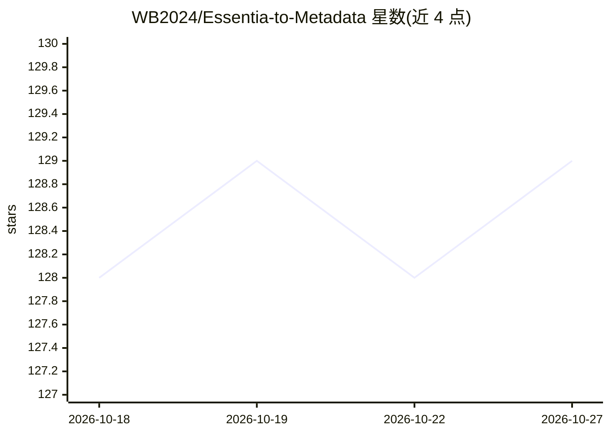

# WB2024/Essentia-to-Metadata

⭐ 129 · Python · MIT · 推送 2026-04-04 · [GitHub](https://github.com/WB2024/Essentia-to-Metadata) · 个人维护

**本地分析音频并自动写入流派/情绪标签的音乐库工具**

基于 Essentia ML 模型的命令行音乐打标工具：读取音频文件，提取频谱、音调与节奏特征，用预训练神经网络（Discogs-400 流派 CNN、MTG-Jamendo 情绪多标签模型）预测流派与情绪，并写入 FLAC/MP3/OGG/M4A 等多种格式的标签。全流程本地运行，无需联网。提供交互式配置与 CLI 自动化模式、dry-run 测试、MusicBrainz Picard 联动（文件监听 + systemd 服务）。Linux/macOS 下以 Python 3.8+ 运行，Docker 支持 CPU 与可选 NVIDIA GPU 模式。

## 筛选速览

| 维度 | 判定 | 备注 |
|---|---|---|
| AI 角色 | `ai-native` | 本体是模型或模型工具 |
| 许可风险 | `permissive` | MIT |
| 部署形态 | `self-host` | docker 或自建部署 |
| 模型依赖 | — | README 未给出锁定关系 |
| 硬件要求 | `cpu-ok` | |
| 安装摩擦 | `low` | 无编译、无系统依赖或容器化 |
| 成熟度 | — | 结构信号不足 |

## 能力要点

- 400 类 Discogs 流派分类与 MTG-Jamendo 情绪多标签检测
- 全离线本地分析，CPU 即可运行（GPU 可选加速）
- 写入 FLAC/MP3/OGG/Opus/M4A/WMA/AIFF/DSF 等 14 种格式标签
- Picard 保存后经 inotifywait + systemd 自动打标

## 适用场景

- 给本地音乐库批量补充流派和情绪标签
- 服务器上与 MusicBrainz Picard 联动实现自动打标
- 用 dry-run 模式先预览预测结果再决定写入

## 场景标签

 · 领域:音频分析/音乐元数据

## 证据(README 行号)

> L33: Unlike tools like MusicBrainz Picard or beets that look up metadata from online databases, **Essentia Music Tagger 
> L37: 3. **Runs ML models** - Pre-trained neural networks predict genres and moods
> L47: 🎸 Genres: Rock - Alternative Rock (32%), Rock - Indie Rock (23%), Rock - Brit Pop (22%) 😊 Moods: Energetic (2.3%), 

## 星数曲线

2026-10-18 128 → 2026-10-27 129（+1）

---
*卡片 v1 · prompt 1.4 · 生成 2026-10-22 · 置信度 high · 依据 README sha `a43abc81f623` · [字段定义](../../DATASET.md)*
