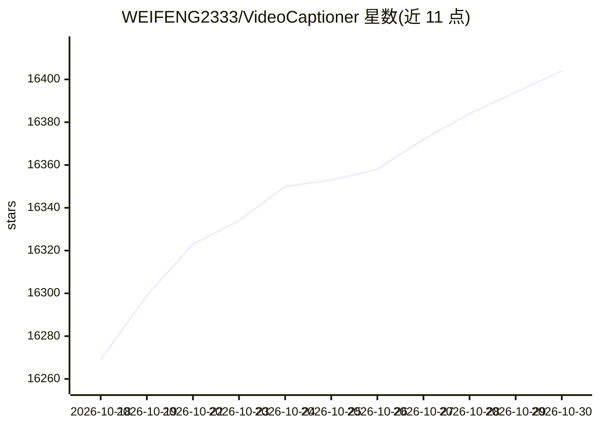

# WEIFENG2333/VideoCaptioner

⭐ 16,404 · Python · GPL-3.0 · 推送 2026-09-12 · [GitHub](https://github.com/WEIFENG2333/VideoCaptioner) · [官网](https://www.videocaptioner.cn) · 个人维护 · 中文 README

**给视频创作者提供 LLM 驱动的字幕生成、优化与翻译工具**

基于大语言模型的视频字幕处理工具，覆盖语音识别、字幕断句、LLM 优化、翻译与视频合成的全流程。提供 CLI 与 GUI 桌面版两种形态，pip 安装即用；必剪语音识别与必应/谷歌翻译为免费功能，无需 API Key。LLM 仅用于字幕优化和大模型翻译，支持所有 OpenAI 兼容接口服务商。另提供 Claude Code Skill，使 AI 编程助手可直接调用该工具处理视频。开发依赖 uv 管理环境。

## 筛选速览

| 维度 | 判定 | 备注 |
|---|---|---|
| AI 角色 | `ai-enhanced` | 去掉 AI 部分产品仍成立 |
| 许可风险 | `viral` | GPL-3.0 |
| 部署形态 | `library` | 以包/库形式分发 |
| 模型依赖 | — | README 未给出锁定关系 |
| 硬件要求 | — | 无带数字的原话,不猜 |
| 安装摩擦 | `low` | 无编译、无系统依赖或容器化 |
| 成熟度 | — | 结构信号不足 |

## 动量与使用信号

- 维护:`active` — 距上次 push 36.1 天,年发版 3,10 位贡献者
- 涨星:近 1 天 **+14**(自 20261016 起算)
- 安装:pypi 包 `videocaptioner` 月下载 992
- 平台:WINDOWS / MACOS · 协议:—

## 能力要点

- 语音识别、断句、LLM 优化、翻译、视频合成一站式 CLI 命令
- 免费功能（必剪识别、必应/谷歌翻译）安装即用、无需 API Key
- 支持所有 OpenAI 兼容接口的服务商
- 提供 Claude Code Skill 供 AI 编程助手调用

## 适用场景

- 为视频批量生成并翻译字幕
- 用 LLM 优化断句和校正已有字幕
- 将字幕烧录进视频或生成配音音轨
- 下载 YouTube、B站视频后直接处理字幕

## 场景标签

`语音识别` `语音合成` · 领域:内容生成

## 证据(README 行号)

> L3:  基于大语言模型的视频字幕处理工具 — 语音识别、字幕优化、翻译、视频合成一站式处理
> L39: |`transcribe`|语音转字幕。引擎：`faster-whisper`、`whisper-api`、`bijian`（免费）、`jianying`（免费）、`whisper-cpp`|
> L100: 音视频输入 → 语音识别 → 字幕断句 → LLM 优化 → 翻译 → 视频合成

## 星数曲线

2026-10-18 16,269 → 2026-10-30 16,404（+135）

---
*卡片 v1 · prompt 1.4 · 生成 2026-10-18 · 置信度 high · 依据 README sha `0a7bf2d19e90` · [字段定义](../../DATASET.md)*
