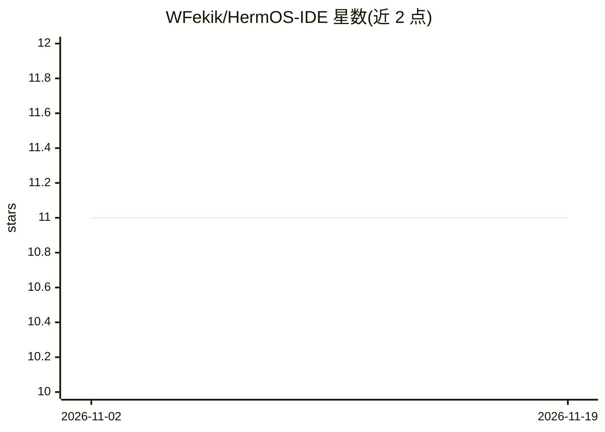

# WFekik/HermOS-IDE

⭐ 11 · TypeScript · MIT · 推送 2026-11-16 · [GitHub](https://github.com/WFekik/HermOS-IDE) · [官网](https://hermos.is-a.dev/) · 个人维护

**本地优先的 AI 编码桌面 IDE：自主 agent 本机改码、跑终端、操作浏览器**

桌面代码编辑器，内置自主编码 agent，完全在本机离线运行：编辑文件、执行终端命令、无头浏览器预览，数据存于本地 SQLite，API 密钥 AES-256-GCM 加密存储且无遥测。Agent 提供 Chat/Architect/Agent 三种模式处理问答到多步重构；通过 MCP（stdio/SSE 服务器）、插件与技能扩展工具能力，可由 agent 直接生成 PPTX/DOCX/PDF。按 BYOK 模式使用用户自己的模型密钥，支持 OpenAI、Anthropic、Groq、Ollama 等云端与本地提供商。Windows/macOS/Linux 提供原生安装包，最低 4GB 内存。

## 筛选速览

| 维度 | 判定 | 备注 |
|---|---|---|
| AI 角色 | `ai-native` | 本体是模型或模型工具 |
| 许可风险 | `permissive` | MIT |
| 部署形态 | `desktop` | 安装包/桌面程序 |
| 模型依赖 | local-ok | 支持本地模型 |
| 硬件要求 | — | 无带数字的原话,不猜 |
| 安装摩擦 | `low` | 无编译、无系统依赖或容器化 |
| 成熟度 | — | 结构信号不足 |

## 能力要点

- 自主 agent 本机执行多步编码任务：读、改、运行、测试
- BYOK 接入云/本地模型（OpenAI、Anthropic、Groq、Ollama 等），密钥 AES-256-GCM 加密
- 支持 stdio/SSE MCP 服务器、插件与技能扩展
- agent 直接生成 PPTX/DOCX/PDF 文档

## 适用场景

- 在本地离线环境用 AI agent 完成多步代码重构
- 通过 MCP 接入文件系统、GitHub、数据库等工具扩展编码助手
- 无云端依赖的开发环境，代码与密钥全部留在本机
- 由 agent 自动生成演示文稿与文档

## 场景标签

`编码 Agent` `浏览器自动化` · 领域:效率与自动化

## 证据(README 行号)

> L8: HermOS IDE is a desktop code editor with a built-in autonomous coding agent. It runs entirely offline on your comput
> L24: |**Autonomous Agent**|Multi-step coding tasks: read, edit, run, test — locally.|
> L15: - **Bring Your Own Keys** — Works with OpenAI, Anthropic Claude, Groq, Mistral, Together, Ollama (local), and more.

## 星数曲线

2026-11-02 11 → 2026-11-19 11（+0）

---
*卡片 v1 · prompt 1.4 · 生成 2026-11-18 · 置信度 high · 依据 README sha `7261160c9585` · [字段定义](../../DATASET.md)*
