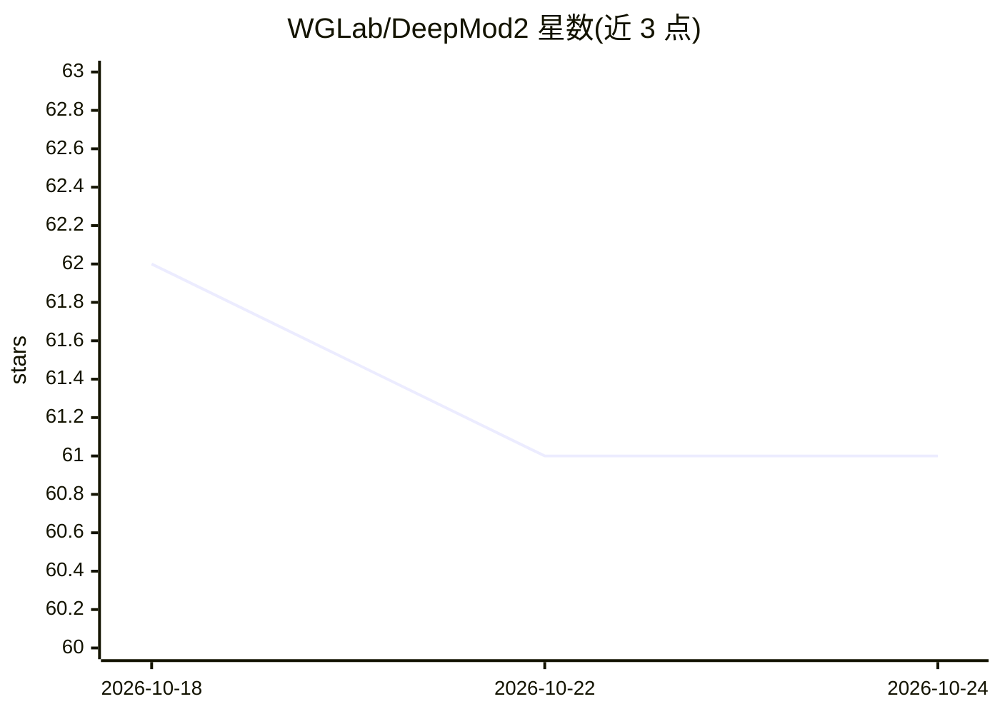

# WGLab/DeepMod2

⭐ 61 · Jupyter Notebook · MIT · 推送 2026-07-21 · [GitHub](https://github.com/WGLab/DeepMod2) · 组织维护

**从纳米孔测序读段检测 DNA 5mC 甲基化的深度学习工具**

面向牛津纳米孔测序数据的计算工具：读取经 Dorado 或 Guppy 碱基识别（含 move table）的 BAM 与 POD5/FAST5 信号文件，用 BiLSTM 或 Transformer 模型预测 CpG 位点的逐读段与逐位点 5mC 甲基化，输出逐读段/逐位点预测文本文件与甲基化标注 BAM，可在 IGV 中可视化。仓库内置对应 R10.4.1 与 R9.4.1 流动池的模型，另提供模型训练与信号绘图代码。用户为生信/基因组学科研开发者，支持多核与 GPU 加速。

## 筛选速览

| 维度 | 判定 | 备注 |
|---|---|---|
| AI 角色 | `ai-native` | 本体是模型或模型工具 |
| 许可风险 | `permissive` | MIT |
| 部署形态 | `None` |  |
| 模型依赖 | — | README 未给出锁定关系 |
| 硬件要求 | — | 无带数字的原话,不猜 |
| 安装摩擦 | `low` | 无编译、无系统依赖或容器化 |
| 成熟度 | — | 结构信号不足 |

## 能力要点

- BiLSTM/Transformer 模型预测逐读段与逐位点 CpG 5mC 甲基化
- 支持 Dorado/Guppy 碱基识别的 POD5/FAST5 输入
- 输出甲基化标注 BAM 并可在 IGV 中按 5mC 着色可视化
- 内置 R10.4.1/R9.4.1 流动池多版本模型并提供训练代码

## 适用场景

- 对纳米孔测序数据做 CpG 位点 5mC 甲基化检测
- 获得参考基因组锚定的逐位点甲基化频率
- 在 IGV 中可视化甲基化标注的 BAM 文件
- 用自己的数据重训甲基化检测模型

## 场景标签

 · 领域:生物信息学/表观遗传学

## 证据(README 行号)

> L2: DeepMod2 is a computational tool for detecting DNA 5mC methylation from Oxford Nanopore reads. It uses a BiLSTM mode
> L7: Ahsan, M.U., Gouru, A., Chan, J. et al. A signal processing and deep learning framework for methylation detection us

## 星数曲线

2026-10-18 62 → 2026-10-24 61（-1）

---
*卡片 v1 · prompt 1.4 · 生成 2026-10-24 · 置信度 high · 依据 README sha `630eeac955e1` · [字段定义](../../DATASET.md)*
