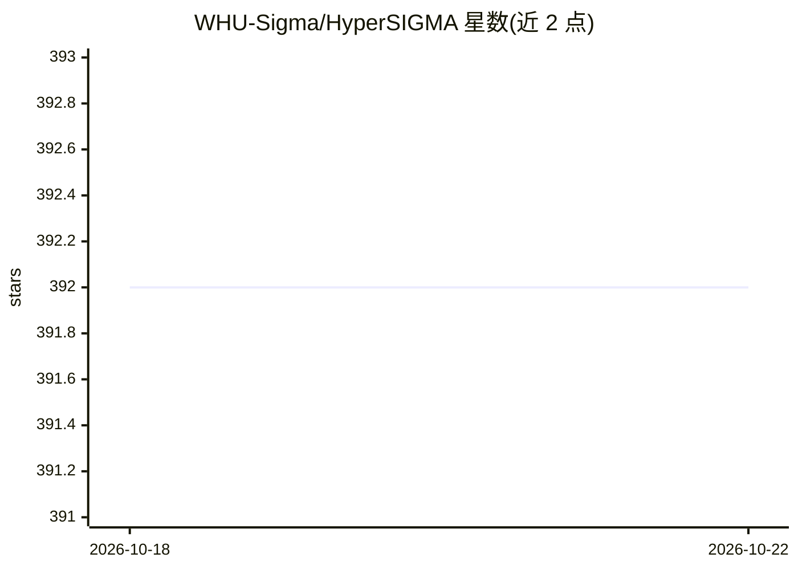

# WHU-Sigma/HyperSIGMA

⭐ 392 · Python · Apache-2.0 · 推送 2026-05-20 · [GitHub](https://github.com/WHU-Sigma/HyperSIGMA) · 组织维护 · 中文 README

**高光谱遥感智能理解基础模型（首个十亿级参数）**

WHU-Sigma 团队发布的高光谱图像（HSI）理解基础模型，发表于 IEEE TPAMI 2025。采用稀疏采样注意力（SSA）与光谱增强模块整合空间/光谱特征；基于自建 HyperGlobal-450K 数据集（1701 景影像、超 2000 万三波段样本）做 MAE 预训练，提供 ViT-B/L/H 骨干权重（Hugging Face 与百度网盘下载）。支持图像分类、目标/异常检测、变化检测、光谱解混、去噪、超分辨率等 7 类任务微调，预训练通过 SLURM 脚本运行。数据集仅供科研使用。

## 筛选速览

| 维度 | 判定 | 备注 |
|---|---|---|
| AI 角色 | `ai-native` | 本体是模型或模型工具 |
| 许可风险 | `permissive` | Apache-2.0 |
| 部署形态 | `None` |  |
| 模型依赖 | — | README 未给出锁定关系 |
| 硬件要求 | — | 无带数字的原话,不猜 |
| 安装摩擦 | `low` | 无编译、无系统依赖或容器化 |
| 成熟度 | — | 结构信号不足 |

## 能力要点

- 稀疏采样注意力（SSA）作为基础模块处理光谱/空间冗余
- HyperGlobal-450K 预训练数据集（1701 景、2000 万+ 三波段图像）
- 提供 ViT-B/L/H 六组预训练权重
- 覆盖分类、检测、解混、去噪、超分等 7 类任务微调

## 适用场景

- 在高光谱遥感数据上做分类或变化检测任务的微调
- 高光谱去噪与超分辨率等低层视觉任务
- 基于公开权重做遥感基础模型研究

## 场景标签

`微调` `模型训练` `图像视频处理` · 领域:感知与多模态

## 证据(README 行号)

> L74: **HyperSIGMA** is the first billion-level foundation model specifically designed for HSI interpretation. To tackle 
> L89: **Figure 2. HyperSIGMA demonstrates superior performance across 16 datasets and 7 tasks, including both high-level 

## 星数曲线

2026-10-18 392 → 2026-10-22 392（+0）

---
*卡片 v1 · prompt 1.4 · 生成 2026-10-21 · 置信度 high · 依据 README sha `4190f67fbe0d` · [字段定义](../../DATASET.md)*
