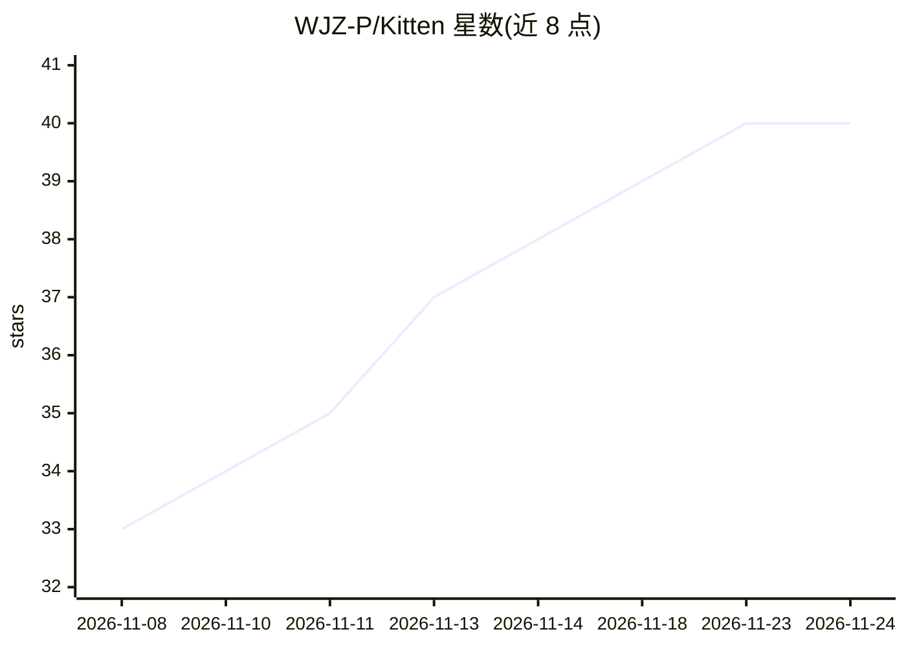

# WJZ-P/Kitten

⭐ 40 · Kotlin · AGPL-3.0 · 推送 2026-11-02 · [GitHub](https://github.com/WJZ-P/Kitten) · 个人维护 · 中文 README

**安卓 AI agent 助手：用副屏代你操作手机应用**

Android 手机端的 AI agent 应用（Android 13+，Kotlin）：通过特权进程拉起虚拟副屏并打开目标应用，结合无障碍与截图识别屏幕内容，代替用户执行点按、输入、滑动等操作，实现发消息、购物、查应用使用记录等任务。支持自定义人设、技能沉淀与自动流程重放，可接 DeepSeek/通义/智谱/OpenAI/本地 Ollama 等模型（用户自带 Key）。以 APK 安装包分发，当前为测试版，主要在小米 HyperOS 上开发测试；API Key 明文存储于应用私有目录。

## 筛选速览

| 维度 | 判定 | 备注 |
|---|---|---|
| AI 角色 | `ai-native` | 本体是模型或模型工具 |
| 许可风险 | `viral` | AGPL-3.0 |
| 部署形态 | `None` |  |
| 模型依赖 | local-ok | 支持本地模型 |
| 硬件要求 | — | 无带数字的原话,不猜 |
| 安装摩擦 | `low` | 无编译、无系统依赖或容器化 |
| 成熟度 | `idea` | |

## 能力要点

- 利用副屏与无障碍/截图识别操作任意应用，无需应用开放接口
- 通过 ADB 配对的增强模式（无线调试），仅开放窄接口
- 技能沉淀与自动流程重放，跑通的操作不再消耗 token
- 用户自带模型 Key，内容只发送至所选模型服务商

## 适用场景

- 用一句话让助手在微信/QQ 代发消息
- 让助手在淘宝搜索并挑选商品
- 通过对话设定闹钟、提醒、读写日历等系统能力

## 场景标签

`GUI 自动化` `AI 助手` · 领域:效率与自动化

## 证据(README 行号)

> L7: **住在你手机里的人性化助手：说一句话，她替你打开 App、一步步点完、看完、办完。默认提供猫娘、鲸鱼娘(超级大肥鱼！)人设，也可以自定义任何你想要的人设！**
> L24: Kitten会利用特权进程拉起副屏，并把需要她操作的软件在副屏上打开，并利用无障碍 & 截图等方式识别屏幕内容并进行具体操作。下面是几个具体例子~

## 星数曲线

2026-11-08 33 → 2026-11-24 40（+7）

---
*卡片 v1 · prompt 1.4 · 生成 2026-11-18 · 置信度 high · 依据 README sha `178737712f14` · [字段定义](../../DATASET.md)*
