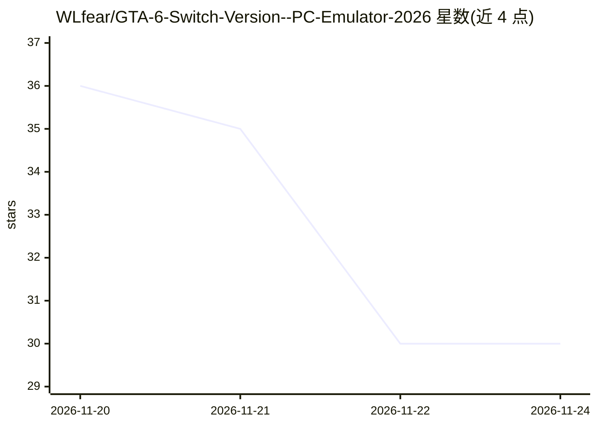

# WLfear/GTA-6-Switch-Version--PC-Emulator-2026

⭐ 18 · Rust · Apache-2.0 · 推送 2026-11-21 · [GitHub](https://github.com/WLfear/GTA-6-Switch-Version--PC-Emulator-2026) · 个人维护

**面向 Windows 玩家的 GTA VI PC 版安装准备与优化指南**

一个以文档形式提供的 Grand Theft Auto VI PC 版安装与配置资源，内容覆盖 Windows 环境准备（系统更新、GPU 驱动、存储检查）、图形与 FPS 优化选项说明、安装故障排查分类、Rockstar Games Launcher 准备步骤及常见问题解答。README 声明该 Windows 安装包仅为配套的设置工具，不包含或安装游戏文件本身；官方 PC 版发布日期与系统要求尚未公布，相关表格标注为未确认。

## 筛选速览

| 维度 | 判定 | 备注 |
|---|---|---|
| AI 角色 | `ai-enhanced` | 去掉 AI 部分产品仍成立 |
| 许可风险 | `permissive` | Apache-2.0 |
| 部署形态 | `desktop` | 安装包/桌面程序 |
| 模型依赖 | — | README 未给出锁定关系 |
| 硬件要求 | — | 无带数字的原话,不猜 |
| 安装摩擦 | `low` | 无编译、无系统依赖或容器化 |
| 成熟度 | `idea` | |

## 能力要点

- 覆盖 Windows 准备、驱动配置、存储检查的安装前检查清单
- 图形设置与 FPS 排障说明（分辨率/纹理/阴影/帧生成等）
- 安装错误与性能问题的分类排查列表
- 官方系统要求表格（当前均标注为未确认）

## 适用场景

- GTA VI PC 版发布前提前准备 Windows 环境与驱动
- 查阅 PC 游戏图形设置与 FPS 排障的通用方法
- 了解官方 PC 版系统要求与发布信息的更新

## 场景标签

 · 领域:游戏/桌面工具

## 证据(README 行号)

> L5: A dedicated PC installation and configuration resource for Grand Theft Auto VI, covering Windows preparation, graphi
> L19: The installation resource focuses on:
> L49: The companion installer does not contain or install GTA VI game files.

## 星数曲线

2026-11-20 36 → 2026-11-24 30（-6）

---
*卡片 v1 · prompt 1.4 · 生成 2026-11-22 · 置信度 low · 依据 README sha `2fe487426686` · [字段定义](../../DATASET.md)*
