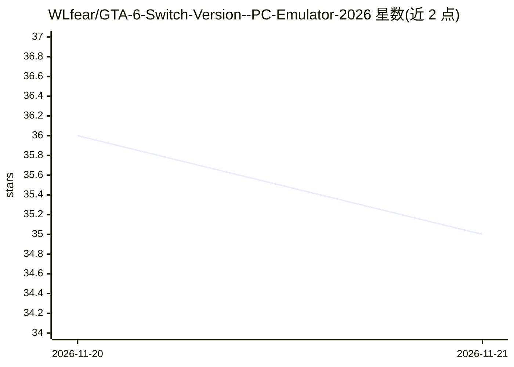

# WLfear/GTA-6-Switch-Version--PC-Emulator-2026

⭐ 35 · Rust · Apache-2.0 · 推送 2026-11-19 · [GitHub](https://github.com/WLfear/GTA-6-Switch-Version--PC-Emulator-2026) · 个人维护

**面向 Windows 玩家的 GTA VI PC 安装准备与设置指南**

一个针对尚未发售的 GTA VI PC 版的 Windows 准备资源：提供系统兼容性检查清单、GPU 驱动更新指引、存储检查、Windows 游戏设置配置、图形选项说明与 FPS 问题排查步骤，并预留了官方配置公布后的更新位置。仓库附带一个 Windows 配套安装包（.exe），README 明确声明该安装包不包含 GTA VI 游戏文件，游戏本体仍需从授权渠道购买。

## 筛选速览

| 维度 | 判定 | 备注 |
|---|---|---|
| AI 角色 | `ai-enhanced` | 去掉 AI 部分产品仍成立 |
| 许可风险 | `permissive` | Apache-2.0 |
| 部署形态 | `desktop` | 安装包/桌面程序 |
| 模型依赖 | — | README 未给出锁定关系 |
| 硬件要求 | — | 无带数字的原话,不猜 |
| 安装摩擦 | `low` | 无编译、无系统依赖或容器化 |
| 成熟度 | — | 结构信号不足 |

## 能力要点

- Windows 10/11 准备清单：系统更新、DirectX、驱动、存储检查
- NVIDIA/AMD/Intel 官方驱动下载指引
- 图形设置与 FPS/卡顿/显示问题排查步骤
- 系统需求表留空，待官方公布后更新

## 适用场景

- 为 GTA VI PC 版提前准备 Windows 环境
- 排查 PC 游戏常见的 FPS、卡顿与显示问题
- 了解 Rockstar Games Launcher 的安装与配置

## 场景标签

 · 领域:游戏/安装工具

## 证据(README 行号)

> L17: This repository is dedicated to Windows users preparing for the future PC edition of GTA VI.
> L49: The companion installer does not contain or install GTA VI game files.

## 星数曲线

2026-11-20 36 → 2026-11-21 35（-1）

---
*卡片 v1 · prompt 1.4 · 生成 2026-11-20 · 置信度 low · 依据 README sha `6954d37a13d3` · [字段定义](../../DATASET.md)*
