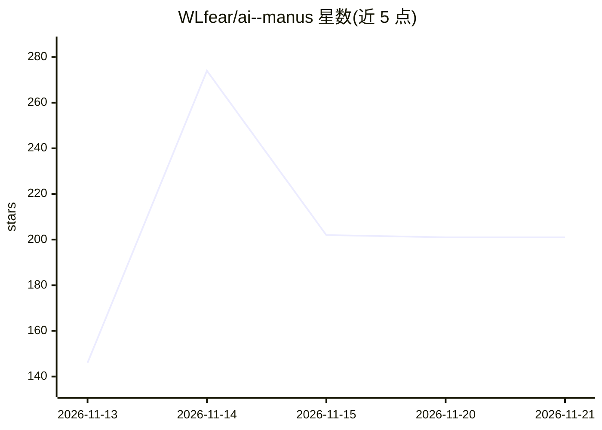

# WLfear/ai--manus

⭐ 201 · Apache-2.0 · 推送 2026-11-19 · [GitHub](https://github.com/WLfear/ai--manus) · 组织维护

**通用自主 AI Agent，代用户执行代码与浏览器操作**

README 描述 Manus 为一个自主 AI Agent：可代用户编写并执行脚本、控制浏览器导航网页、填写表单、执行多步任务。定位为面向家庭、学习与轻量办公场景的个人助手，强调后台运行与跨会话任务复用。README 提供最低系统配置（64 位系统、双核 CPU、4GB 内存）与启动流程说明，但未给出具体的安装命令、下载链接内容或依赖清单，说明内容以功能介绍为主。

## 筛选速览

| 维度 | 判定 | 备注 |
|---|---|---|
| AI 角色 | `ai-native` | 本体是模型或模型工具 |
| 许可风险 | `permissive` | Apache-2.0 |
| 部署形态 | `None` |  |
| 模型依赖 | — | README 未给出锁定关系 |
| 硬件要求 | — | 无带数字的原话,不猜 |
| 安装摩擦 | `low` | 无编译、无系统依赖或容器化 |
| 成熟度 | — | 结构信号不足 |

## 能力要点

- 自主执行代码与浏览器控制（导航、填表、信息收集）
- 多步任务执行，最小监督下完成任务
- 跨会话保持任务模式一致性

## 适用场景

- 让 Agent 代为收集网页信息并整理研究笔记
- 自动处理填表、页面检查等重复性小事
- 运行快速脚本实验并对比结果

## 场景标签

`AI 助手` `编码 Agent` `浏览器自动化` · 领域:效率与自动化

## 证据(README 行号)

> L10: - **Autonomous Code Execution:** Manus AI agent runs code on its own to complete tasks, so you can focus on decisio
> L18: Manus is an autonomous AI agent designed to run code and control a browser on your behalf. Instead of acting like a
> L41: |**Memory (RAM)**|4 GB|8 GB or more for heavy Manus autonomous tasks|

## 星数曲线

2026-11-13 146 → 2026-11-21 201（+55）

---
*卡片 v1 · prompt 1.4 · 生成 2026-11-20 · 置信度 mid · 依据 README sha `95066437596f` · [字段定义](../../DATASET.md)*
