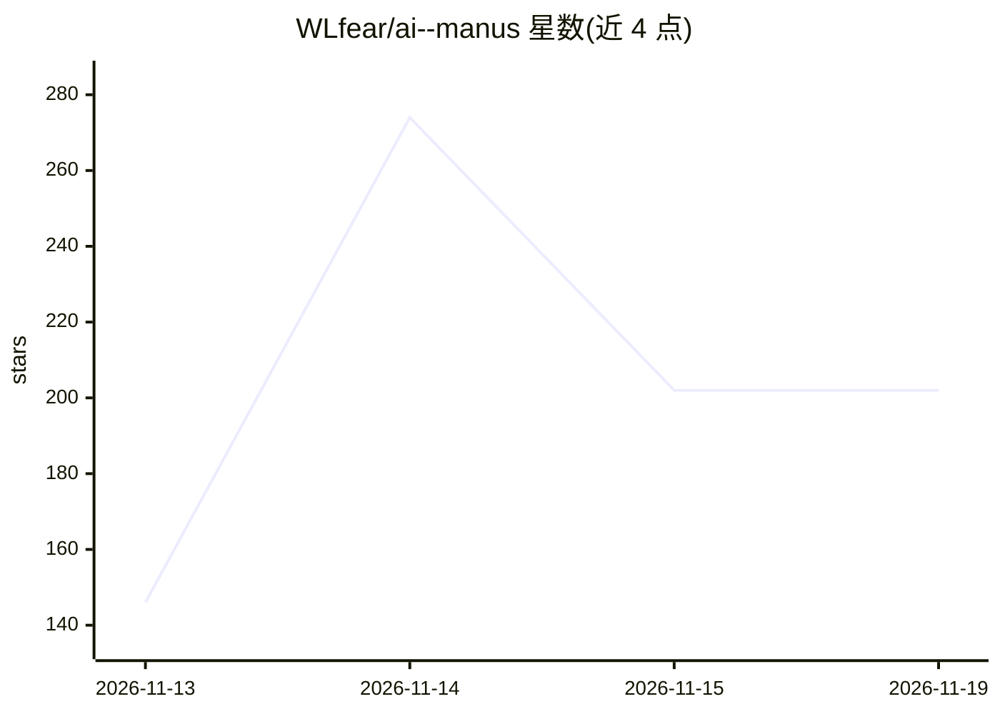

# WLfear/ai--manus

⭐ 202 · Apache-2.0 · 推送 2026-11-18 · [GitHub](https://github.com/WLfear/ai--manus) · 个人维护

**面向个人用户的自治 AI Agent：代用户执行代码与浏览器操作**

README 将该产品定位为自治 AI Agent：可自行编写并执行脚本、控制浏览器导航网页、填写表单、执行多步骤任务。目标场景为学习、家庭与轻量办公，强调无需深度编程背景即可使用。安装部分未给出可执行命令，仅提供五步准备-配置-测试-应用流程描述，并要求稳定网络连接与后台运行权限；同时给出 64 位系统、4GB 内存（推荐 8GB）等兼容性要求。README 通篇为功能介绍与使用建议，未涉及源码结构或 API 说明。

## 筛选速览

| 维度 | 判定 | 备注 |
|---|---|---|
| AI 角色 | `ai-native` | 本体是模型或模型工具 |
| 许可风险 | `permissive` | Apache-2.0 |
| 部署形态 | `None` |  |
| 模型依赖 | — | README 未给出锁定关系 |
| 硬件要求 | — | 无带数字的原话,不猜 |
| 安装摩擦 | `low` | 无编译、无系统依赖或容器化 |
| 成熟度 | — | 结构信号不足 |

## 能力要点

- 自治执行代码脚本与浏览器操作（导航、填表、信息收集）
- 多步骤任务执行，支持后台持续运行
- 跨会话保持任务模式，无需重复说明工作流
- 定位为轻量个人助手，面向非开发者使用

## 适用场景

- 收集网页资料并整理研究笔记
- 自动填写重复性表单或检查页面更新
- 轻量办公场景下汇总多标签页信息生成小结

## 场景标签

`AI 助手` `浏览器自动化` · 领域:效率与自动化

## 证据(README 行号)

> L18: Manus is an autonomous AI agent designed to run code and control a browser on your behalf. Instead of acting like a
> L33: - **Built For Small Scale:** Manus autonomous tasks are designed for home, study, and light work, not just large en

## 星数曲线

2026-11-13 146 → 2026-11-19 202（+56）

---
*卡片 v1 · prompt 1.4 · 生成 2026-11-19 · 置信度 mid · 依据 README sha `c06c32a8c955` · [字段定义](../../DATASET.md)*
