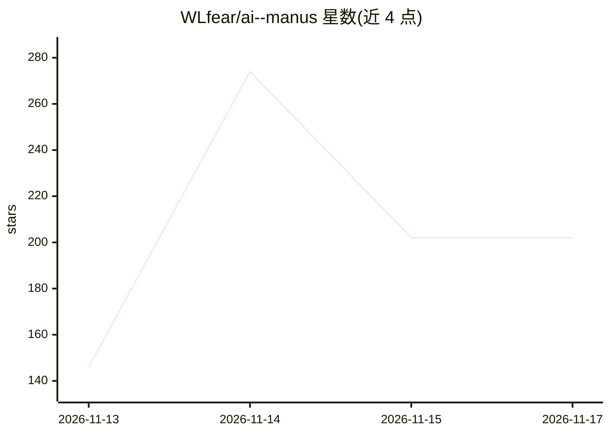

# WLfear/ai--manus

⭐ 202 · Apache-2.0 · 推送 2026-11-15 · [GitHub](https://github.com/WLfear/ai--manus) · 个人维护

**自主 AI Agent：代用户执行代码与控制浏览器完成任务**

自述为面向家庭、学习与轻量工作场景的自主 AI Agent：用户以自然语言描述需求，Agent 自行规划步骤，可编写并执行脚本、打开网页、填写表单、与页面元素交互并完成多步骤任务，无需用户具备编程背景；代码执行与浏览器控制可在同一任务流中衔接。README 为介绍性文案，未给出安装命令、依赖清单或技术架构说明；文末附大段搜索关键词列表，并出现『Download Manus』『PROMO2026』等下载/推广提示。面向非开发者终端用户。

## 筛选速览

| 维度 | 判定 | 备注 |
|---|---|---|
| AI 角色 | `ai-native` | 本体是模型或模型工具 |
| 许可风险 | `permissive` | Apache-2.0 |
| 部署形态 | `None` |  |
| 模型依赖 | — | README 未给出锁定关系 |
| 硬件要求 | — | 无带数字的原话,不猜 |
| 安装摩擦 | `low` | 无编译、无系统依赖或容器化 |
| 成熟度 | — | 结构信号不足 |

## 能力要点

- 自主编写并执行代码完成多步骤任务
- 浏览器控制：导航网页、填写表单、采集信息
- 跨会话记住任务模式并重复应用

## 适用场景

- 让学生整理研究资料、运行小脚本
- 让 Agent 汇总多网页信息用于小报告
- 把重复性的查页面、整理文件等杂务交给后台 Agent

## 场景标签

`编码 Agent` `浏览器自动化` · 领域:效率与自动化

## 证据(README 行号)

> L10: - **Autonomous Code Execution:** Manus AI agent runs code on its own to complete tasks, so you can focus on decisio
> L18: Manus is an autonomous AI agent designed to run code and control a browser on your behalf. Instead of acting like a

## 星数曲线

2026-11-13 146 → 2026-11-17 202（+56）

---
*卡片 v1 · prompt 1.4 · 生成 2026-11-17 · 置信度 low · 依据 README sha `0f78ee3a5dd2` · [字段定义](../../DATASET.md)*
