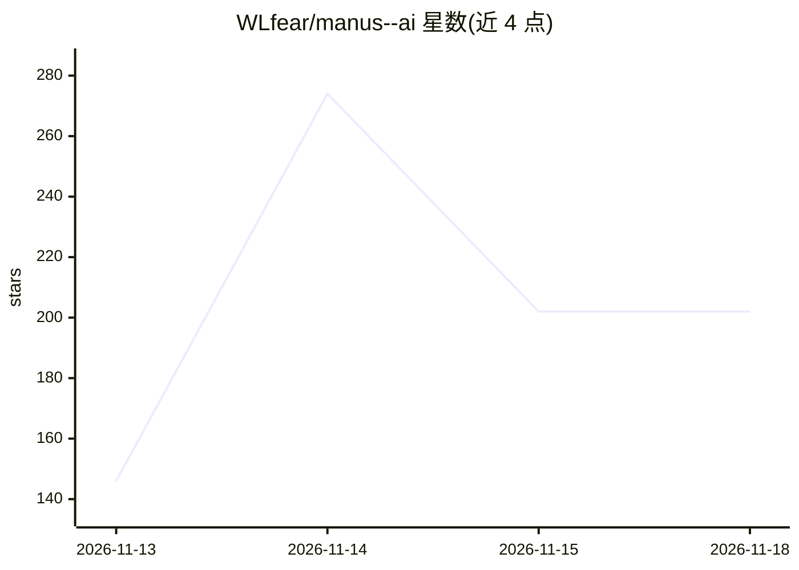

# WLfear/manus--ai

⭐ 202 · Apache-2.0 · 推送 2026-11-17 · [GitHub](https://github.com/WLfear/manus--ai) · 个人维护

**面向个人用户的自主 AI Agent：自动执行代码与浏览器操作**

README 描述的 Manus 是一个自主 AI agent，定位为家庭、学习与轻量办公场景的个人助手：用户以自然语言下达指令，agent 自行编写并执行脚本、打开网页、与页面元素交互、完成多步任务，并可跨会话复用已学到的流程模式。README 以功能宣传与使用建议为主，未给出任何安装命令、技术架构、模型接入方式或源码入口，仅有 'Download Manus' 字样与一张软硬件兼容性表（4GB 内存起步）。描述中提及的沙箱环境执行工具未在 README 正文展开。

## 筛选速览

| 维度 | 判定 | 备注 |
|---|---|---|
| AI 角色 | `ai-native` | 本体是模型或模型工具 |
| 许可风险 | `permissive` | Apache-2.0 |
| 部署形态 | `None` |  |
| 模型依赖 | — | README 未给出锁定关系 |
| 硬件要求 | — | 无带数字的原话,不猜 |
| 安装摩擦 | `low` | 无编译、无系统依赖或容器化 |
| 成熟度 | — | 结构信号不足 |

## 能力要点

- 自主执行代码与控制浏览器，完成多步任务
- 面向非开发者，定位家庭、学习与轻量办公场景
- README 给出软硬件兼容性表（双核 CPU / 4GB RAM 起步）

## 适用场景

- 让 agent 代为执行重复性的脚本运行与网页操作
- 整理研究笔记、收集多页参考资料
- 远程排障时快速检查系统页面与整理诊断步骤

## 场景标签

`AI 助手` `浏览器自动化` `编码 Agent` · 领域:效率与自动化

## 证据(README 行号)

> L10: - **Autonomous Code Execution:** Manus AI agent runs code on its own to complete tasks, so you can focus on decisio
> L18: Manus is an autonomous AI agent designed to run code and control a browser on your behalf. Instead of acting like a

## 星数曲线

2026-11-13 146 → 2026-11-18 202（+56）

---
*卡片 v1 · prompt 1.4 · 生成 2026-11-18 · 置信度 mid · 依据 README sha `c06e59c45084` · [字段定义](../../DATASET.md)*
