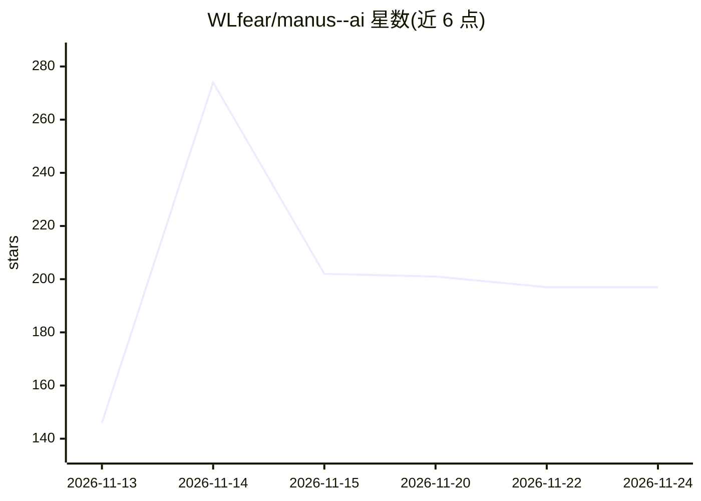

# WLfear/manus--ai

⭐ 193 · Apache-2.0 · 推送 2026-11-21 · [GitHub](https://github.com/WLfear/manus--ai) · 个人维护

**面向个人用户的自主 AI Agent：代为执行代码与浏览器操作**

一个通用自主 AI Agent，运行在沙盒环境中，可自主执行代码、控制浏览器（导航网页、填写表单、收集信息）并完成多步骤任务。定位为面向家庭、学习与轻量办公的个人助手，强调无需深度编程知识即可委托重复性任务，跨会话保持行为一致。README 仅提供最低硬件配置（64 位系统、双核 CPU、4 GB 内存）与使用步骤说明，未给出源码获取、安装命令或许可证信息，下载入口为独立安装包形式。

## 筛选速览

| 维度 | 判定 | 备注 |
|---|---|---|
| AI 角色 | `ai-native` | 本体是模型或模型工具 |
| 许可风险 | `permissive` | Apache-2.0 |
| 部署形态 | `None` |  |
| 模型依赖 | — | README 未给出锁定关系 |
| 硬件要求 | — | 无带数字的原话,不猜 |
| 安装摩擦 | `low` | 无编译、无系统依赖或容器化 |
| 成熟度 | — | 结构信号不足 |

## 能力要点

- 自主执行代码与控制浏览器的多步骤任务 Agent
- 沙盒环境中运行各类工具与操作
- 面向家庭、学习与轻量办公场景的自动化
- README 给出系统/CPU/内存/权限的最低配置表

## 适用场景

- 让 Agent 代为收集多个网页的信息并汇总
- 自动整理研究笔记、运行小脚本和计算
- 把填表、文件整理等重复性任务交给后台助手
- 开发测试中快速运行小实验而无需搭建完整环境

## 场景标签

`AI 助手` `浏览器自动化` · 领域:效率与自动化

## 证据(README 行号)

> L10: - **Autonomous Code Execution:** Manus AI agent runs code on its own to complete tasks, so you can focus on decisio
> L18: Manus is an autonomous AI agent designed to run code and control a browser on your behalf. Instead of acting like a

## 星数曲线

2026-11-13 146 → 2026-11-24 197（+51）

---
*卡片 v1 · prompt 1.4 · 生成 2026-11-20 · 置信度 low · 依据 README sha `148cfe63626f` · [字段定义](../../DATASET.md)*
