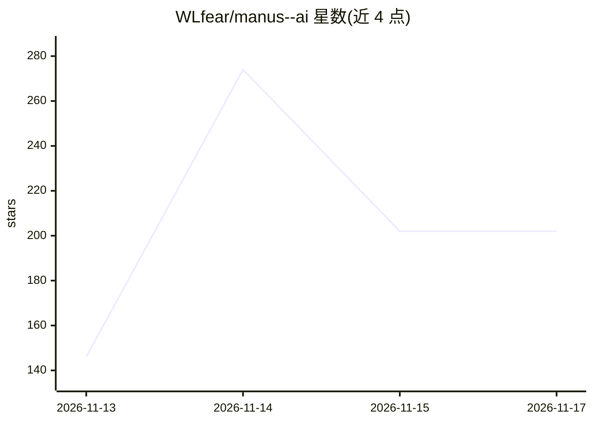

# WLfear/manus--ai

⭐ 202 · Apache-2.0 · 推送 2026-11-15 · [GitHub](https://github.com/WLfear/manus--ai) · 个人维护

**面向个人日常任务的自主 AI Agent：代跑代码与控制浏览器**

README 宣称其为自主 AI 代理，可在沙箱环境中运行工具与操作：自主编写并执行脚本、控制浏览器完成网页导航、表单填写与信息收集，执行多步骤任务。定位为家庭、学习与轻量办公场景的后台个人助手，面向无需编程背景的普通用户。列出最低配置表（双核 CPU、4GB 内存）与上手步骤，但 README 未提供任何具体安装命令、依赖说明或代码入口，仅含下载指引与 SEO 式关键词列表。

## 筛选速览

| 维度 | 判定 | 备注 |
|---|---|---|
| AI 角色 | `ai-native` | 本体是模型或模型工具 |
| 许可风险 | `permissive` | Apache-2.0 |
| 部署形态 | `None` |  |
| 模型依赖 | — | README 未给出锁定关系 |
| 硬件要求 | — | 无带数字的原话,不猜 |
| 安装摩擦 | `low` | 无编译、无系统依赖或容器化 |
| 成熟度 | — | 结构信号不足 |

## 能力要点

- 自主编写并执行代码完成任务
- 浏览器控制：导航网页、填写表单、收集信息
- 脚本与浏览器操作可在同一工作流中衔接
- 面向多步骤任务的后台个人助手定位

## 适用场景

- 让代理代跑小脚本和快速实验
- 自动浏览多个网页收集资料并整理摘要
- 把重复性的日常小任务委托给后台代理

## 场景标签

`AI 助手` `浏览器自动化` `编码 Agent` · 领域:效率与自动化

## 证据(README 行号)

> L10: - **Autonomous Code Execution:** Manus AI agent runs code on its own to complete tasks, so you can focus on decisio
> L18: Manus is an autonomous AI agent designed to run code and control a browser on your behalf. Instead of acting like a

## 星数曲线

2026-11-13 146 → 2026-11-17 202（+56）

---
*卡片 v1 · prompt 1.4 · 生成 2026-11-17 · 置信度 mid · 依据 README sha `0f78ee3a5dd2` · [字段定义](../../DATASET.md)*
