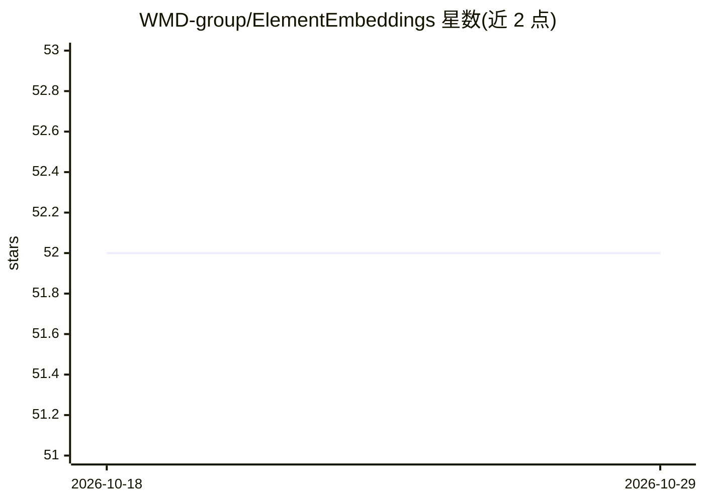

# WMD-group/ElementEmbeddings

⭐ 52 · Python · MIT · 推送 2026-10-04 · [GitHub](https://github.com/WMD-group/ElementEmbeddings) · [官网](https://wmd-group.github.io/ElementEmbeddings/) · 组织维护

**化学元素嵌入表示的分析与特征化 Python 库**

面向材料信息学研究者的 Python 包：提供 Embedding 类加载多种元素/离子物种表示方案（如 magpie），计算距离与相似性统计度量，生成热力图与 UMAP 降维散点图以比较不同嵌入方案的相关性；并可对化学组成（公式字符串或 pandas 数据框）按指定表示方案与池化方式（mean/sum）进行特征化，输出可用于机器学习的特征数据框。通过 pip/uv/conda 安装，维护者为帝国理工学院材料系成员。

## 筛选速览

| 维度 | 判定 | 备注 |
|---|---|---|
| AI 角色 | `ai-ecosystem` | LLM/agent 周边工具 |
| 许可风险 | `permissive` | MIT |
| 部署形态 | `library` | 以包/库形式分发 |
| 模型依赖 | — | README 未给出锁定关系 |
| 硬件要求 | — | 无带数字的原话,不猜 |
| 安装摩擦 | `low` | 无编译、无系统依赖或容器化 |
| 成熟度 | — | 结构信号不足 |

## 能力要点

- Embedding 类加载并分析多种元素/离子物种嵌入方案
- 热力图与 UMAP 二维降维可视化比较嵌入方案
- composition_featuriser 按多种表示方案与池化统计特征化化学组成
- 支持添加自定义嵌入方案的数据文件流程

## 适用场景

- 比较不同原子嵌入方案在一致框架下的相关性与差异
- 为机器学习模型准备化学组成的特征向量
- 可视化元素表示的二维结构

## 场景标签

 · 领域:材料信息学/计算化学

## 证据(README 行号)

> L15: The **Element Embeddings** package provides high-level tools for analysing elemental and ionic species
> L30: to interpret these models. As such, we aim to evaluate and compare different atomic embedding
> L115: The package can also be used to featurise compositions. Your data could be a list of formula strings or a pandas d

## 星数曲线

2026-10-18 52 → 2026-10-29 52（+0）

---
*卡片 v1 · prompt 1.4 · 生成 2026-10-25 · 置信度 high · 依据 README sha `ed1cb4194f37` · [字段定义](../../DATASET.md)*
