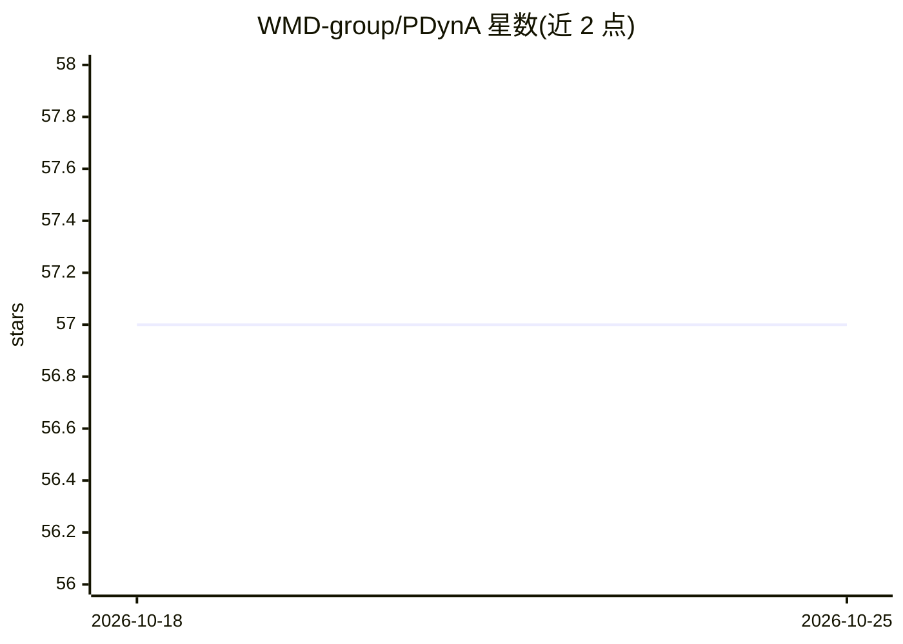

# WMD-group/PDynA

⭐ 57 · Python · MIT · 推送 2026-08-15 · [GitHub](https://github.com/WMD-group/PDynA) · 组织维护

**分析钙钛矿分子动力学轨迹结构动力学的 Python 包**

面向材料科学研究者的钙钛矿结构动力学分析库：读取 VASP-XDATCAR、XYZ、EXTXYZ、PDB、ASE、LAMMPS dump 等格式的分子动力学轨迹，核心类为 Trajectory；自动识别八面体网络与有机 A 位分子，输出晶格参数、八面体倾转与畸变（对应 Glazer 记号）、A 位分子取向与位移、径向分布函数等性质；计算可经 joblib 并行加速。提供 PyPI 安装与示例轨迹，附有 2023 年发表于 J. Phys. Chem. C 的论文。结构匹配在正交、角共享连接体系下效果最佳。

## 筛选速览

| 维度 | 判定 | 备注 |
|---|---|---|
| AI 角色 | `ai-enhanced` | 去掉 AI 部分产品仍成立 |
| 许可风险 | `permissive` | MIT |
| 部署形态 | `library` | 以包/库形式分发 |
| 模型依赖 | — | README 未给出锁定关系 |
| 硬件要求 | — | 无带数字的原话,不猜 |
| 安装摩擦 | `low` | 无编译、无系统依赖或容器化 |
| 成熟度 | — | 结构信号不足 |

## 能力要点

- 读取 VASP-XDATCAR/XYZ/PDB/ASE/LAMMPS 等多种 MD 轨迹格式
- 八面体倾转与畸变定量计算及空间相关性（等效 Glazer 记号）
- 自动识别八面体网络与 A 位有机分子
- joblib 并行加速，可调 multi_thread 参数

## 适用场景

- 分析金属卤化物钙钛矿 MD 轨迹的八面体倾转与畸变
- 提取 A 位分子取向、位移与径向分布函数等结构描述符
- 将结构动力学描述符用于论文发表中的钙钛矿相变与局域结构研究

## 场景标签

 · 领域:材料科学/计算化学

## 证据(README 行号)

> L7: **P**erovskite **Dyn**amics **A**nalysis (**PDynA**) is a Python package for analysis of perovskite structural dynam
> L18: - The octahedral distortion and tilting calculation is the core feature of this package, which can quantitatively e

## 星数曲线

2026-10-18 57 → 2026-10-25 57（+0）

---
*卡片 v1 · prompt 1.4 · 生成 2026-10-24 · 置信度 mid · 依据 README sha `84dc0a16ee0f` · [字段定义](../../DATASET.md)*
