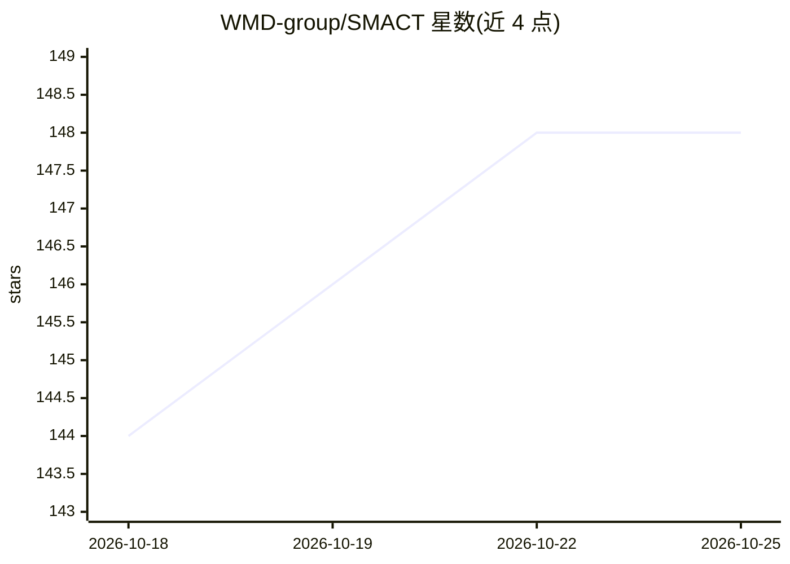

# WMD-group/SMACT

⭐ 148 · Python · NOASSERTION · 推送 2026-10-25 · [GitHub](https://github.com/WMD-group/SMACT) · [官网](https://smact.readthedocs.io) · 组织维护

**面向材料设计的快速筛选与信息学 Python 库**

SMACT（Semiconducting Materials by Analogy and Chemical Theory）是基于化学元素数据的材料筛选工具集：以 Element/Species 类为核心，通过电荷中性、电负性顺序等化学过滤器对元素组合做快速筛选，支持混合价化合物校验、可持续性（元素丰度/HHI）过滤、晶格构建与结构/掺杂预测。提供基于预训练深度学习模型（如 ROOST 带隙预测器）的组成-性质预测模块，氧化态数据源自 ICSD 2024。经 pip/conda 安装，面向计算材料科研用户。

## 筛选速览

| 维度 | 判定 | 备注 |
|---|---|---|
| AI 角色 | `ai-native` | 本体是模型或模型工具 |
| 许可风险 | `permissive` | NOASSERTION |
| 部署形态 | `library` | 以包/库形式分发 |
| 模型依赖 | — | README 未给出锁定关系 |
| 硬件要求 | — | 无带数字的原话,不猜 |
| 安装摩擦 | `low` | 无编译、无系统依赖或容器化 |
| 成熟度 | — | 结构信号不足 |

## 能力要点

- 基于电荷中性与电负性顺序的化学过滤快速筛选元素组合
- 组成-性质预测模块使用预训练深度学习模型（ROOST 带隙预测器）
- 支持混合价化合物、ICSD 2024 氧化态数据、可持续性过滤
- 含结构预测、掺杂预测与晶格参数估算模块，可与 Pymatgen 互转

## 适用场景

- 在本机快速筛选假想无机材料的候选组成
- 为机器学习模型生成材料组成表示或喂入候选集
- 高通量预测 p 型/n 型掺杂元素与带隙等性质

## 场景标签

`科研工具` · 领域:学习与行业

## 证据(README 行号)

> L17: **Semiconducting Materials by Analogy and Chemical Theory** (SMACT) is a collection of rapid screening and informat
> L58: - The property prediction module enables composition-to-property prediction using pretrained deep learning models, 
> L96:  - **property_prediction**: A submodule for composition-to-property prediction using pretrained deep learning model

## 星数曲线

2026-10-18 144 → 2026-10-25 148（+4）

---
*卡片 v1 · prompt 1.4 · 生成 2026-10-22 · 置信度 high · 依据 README sha `feee851e92d1` · [字段定义](../../DATASET.md)*
