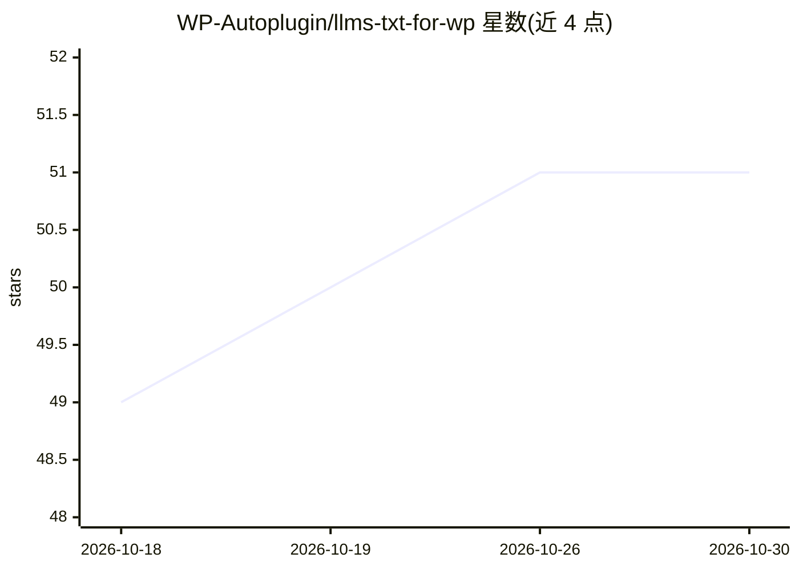

# WP-Autoplugin/llms-txt-for-wp

⭐ 51 · PHP · 推送 2026-03-09 · [GitHub](https://github.com/WP-Autoplugin/llms-txt-for-wp) · 个人维护

**WordPress 插件：为站点生成 llms.txt 与文章 Markdown 版本**

面向 WordPress 站长的内容输出插件：自动聚合站点内容生成 llms.txt 文件，按 llms-txt 标准向大语言模型声明站点结构与内容用途；支持将文章转为 Markdown 版本（URL 加 .md、Accept 头、link 标签三种访问方式），响应含 X-Markdown-Tokens 头标注 token 数。管理后台可选择纳入的文章类型、数量与特定页面。以 ZIP 安装包形式经 WordPress 插件目录上传安装，GPL v2+ 许可。

## 筛选速览

| 维度 | 判定 | 备注 |
|---|---|---|
| AI 角色 | `ai-enhanced` | 去掉 AI 部分产品仍成立 |
| 许可风险 | `none` | — |
| 部署形态 | `desktop` | 安装包/桌面程序 |
| 模型依赖 | — | README 未给出锁定关系 |
| 硬件要求 | — | 无带数字的原话,不猜 |
| 安装摩擦 | `low` | 无编译、无系统依赖或容器化 |
| 成熟度 | — | 结构信号不足 |

## 能力要点

- 自动聚合站点内容生成 llms.txt 文件
- 文章 Markdown 版本输出，三种访问方式（.md 后缀/Accept 头/link 标签）
- Markdown 响应含 X-Markdown-Tokens 头标注 token 数
- 后台可配置纳入的文章类型、数量与特定页面

## 适用场景

- 让我的 WordPress 站点内容被 LLM 工具发现和引用
- 为文章提供轻量的 Markdown 版本链接
- 控制哪些内容出现在面向 AI 的 llms.txt 中

## 场景标签

 · 领域:内容管理/网站工具

## 证据(README 行号)

> L3: LLMs.txt for WP is a WordPress plugin designed to generate machine-learning-friendly content from your site. It auto
> L5: Additionally, this plugin allows you to access **Markdown versions of your posts** by appending `.md` to the post UR

## 星数曲线

2026-10-18 49 → 2026-10-30 51（+2）

---
*卡片 v1 · prompt 1.4 · 生成 2026-10-24 · 置信度 mid · 依据 README sha `3d60db628498` · [字段定义](../../DATASET.md)*
