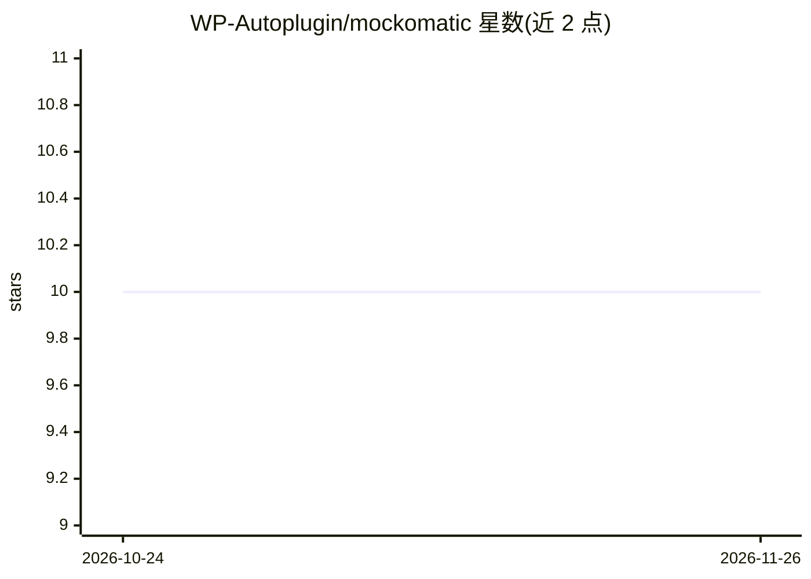

# WP-Autoplugin/mockomatic

⭐ 10 · PHP · 推送 2025-12-16 · [GitHub](https://github.com/WP-Autoplugin/mockomatic) · 组织维护

**用 AI 生成 WordPress 演示站点内容的插件**

免费 WordPress 插件，用于在 wp-admin 中批量生成演示内容：一次运行生成文章、页面、分类、标签和特色图像，输出结构化 Gutenberg 块标记。文本生成支持 OpenAI 与 Google Gemini 模型，图像生成走 Replicate。使用用户自带的 API key，无代理与额外费用。提供生成进度日志、中途停止、逐项编辑链接。要求 WordPress 6.0+ 与 PHP 7.4+，面向原型与 staging 站点搭建者。

## 筛选速览

| 维度 | 判定 | 备注 |
|---|---|---|
| AI 角色 | `ai-native` | 本体是模型或模型工具 |
| 许可风险 | `none` | — |
| 部署形态 | `None` |  |
| 模型依赖 | — | README 未给出锁定关系 |
| 硬件要求 | — | 无带数字的原话,不猜 |
| 安装摩擦 | `low` | 无编译、无系统依赖或容器化 |
| 成熟度 | — | 结构信号不足 |

## 能力要点

- 一次生成文章、页面、分类、标签与特色图像
- 支持 OpenAI/Gemini 文本模型与 Replicate 多种图像模型
- 生成合法 Gutenberg 块标记，可直接编辑
- 自带 API key 设置，无代理与额外费用

## 适用场景

- 为原型或 staging 站点批量填充演示文章与页面
- 生成带分类标签和配图的完整演示站点
- 用不同提示词快速生成多套内容变体

## 场景标签

`图像生成` `AI 写作` · 领域:内容生成

## 证据(README 行号)

> L3: Mockomatic is a free WordPress plugin that auto-builds believable demo sites with AI. Generate posts, pages, categor
> L23: ### AI Content Generation
> L93: **Text (OpenAI):** `gpt-5.1`, `gpt-5`, `gpt-5-mini`, `gpt-5-nano`, `gpt-5-chat-latest`, `gpt-4.5-preview`, `gpt-4.1

## 星数曲线

2026-10-24 10 → 2026-11-26 10（+0）

---
*卡片 v1 · prompt 1.4 · 生成 2026-11-20 · 置信度 high · 依据 README sha `364df3a598d6` · [字段定义](../../DATASET.md)*
