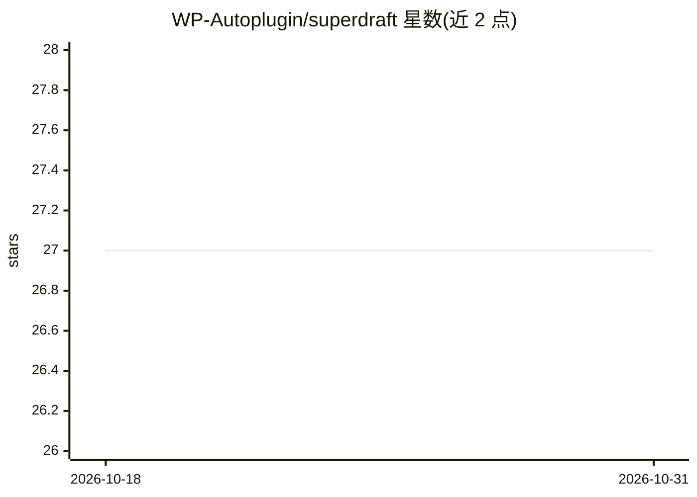

# WP-Autoplugin/superdraft

⭐ 27 · PHP · 推送 2026-07-10 · [GitHub](https://github.com/WP-Autoplugin/superdraft) · [官网](https://wordpress.org/plugins/superdraft/) · 组织维护

**WordPress 写作助手插件：AI 补全、标签建议与图像生成**

免费开源的 WordPress 内容创作插件，集成于区块编辑器侧边栏。功能包括基于内容的标签/分类建议（支持批量后台处理）、写作建议与 SEO 提示、触发式自动补全、行内句子补全（类 Smart Compose）以及特色图像的文生图与局部编辑。采用 BYOK 模式，支持任意 OpenAI 兼容 API（含本地部署模型），可为各功能分别配置模型；提供可覆盖的提示词模板、日志统计与大量 WordPress 钩子。要求 WordPress 6.0+ 与 PHP 7.4+。

## 筛选速览

| 维度 | 判定 | 备注 |
|---|---|---|
| AI 角色 | `ai-native` | 本体是模型或模型工具 |
| 许可风险 | `none` | — |
| 部署形态 | `None` |  |
| 模型依赖 | — | README 未给出锁定关系 |
| 硬件要求 | — | 无带数字的原话,不猜 |
| 安装摩擦 | `low` | 无编译、无系统依赖或容器化 |
| 成熟度 | — | 结构信号不足 |

## 能力要点

- AI 标签/分类建议，支持批量编辑后台处理
- 上下文感知补全与行内句子补全（Smart Compose）
- 特色图像文生图与局部编辑，集成媒体库
- BYOK + 任意 OpenAI 兼容 API，各功能可配不同模型

## 适用场景

- 写博客时获得写作建议、SEO 提示与自动补全
- 为存量文章批量生成并分配标签与分类
- 在编辑器内直接生成和编辑文章特色图

## 场景标签

`AI 写作` `图像生成` · 领域:内容生成

## 证据(README 行号)

> L3: Superdraft is a free WordPress plugin that enhances your content creation workflow with AI-powered tools. It seamles
> L285: Superdraft supports custom models: you can plug in any OpenAI-compatible API by providing the endpoint URL, model 

## 星数曲线

2026-10-18 27 → 2026-10-31 27（+0）

---
*卡片 v1 · prompt 1.4 · 生成 2026-10-26 · 置信度 high · 依据 README sha `872d551b1c0d` · [字段定义](../../DATASET.md)*
