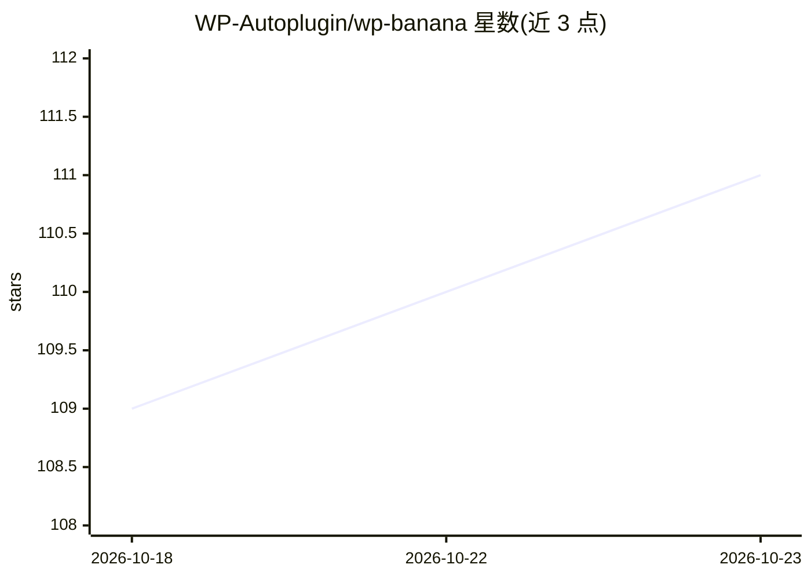

# WP-Autoplugin/wp-banana

⭐ 111 · PHP · 推送 2026-05-02 · [GitHub](https://github.com/WP-Autoplugin/wp-banana) · 组织维护

**WordPress 媒体库内直接生成与编辑 AI 图片的插件**

WordPress 插件，在后台媒体库、文章编辑器与 Elementor/WooCommerce 等界面内提供 AI 图片生成、编辑与多图合成功能。采用 BYOK（自带 API Key）方式接入 fal.ai、Google AI Studio（Gemini/Imagen）、OpenAI 与 Replicate 四个服务商，可选用数十种模型（FLUX.2、Nano Banana 系列、GPT-Image、Seedream 等），支持 4K 分辨率、非破坏性编辑历史与撤销、命令面板集成。要求 WordPress 6.0+、PHP 7.4+ 及服务器启用 ImageMagick，通过 git clone 到插件目录安装，GPL 开源免费。

## 筛选速览

| 维度 | 判定 | 备注 |
|---|---|---|
| AI 角色 | `ai-native` | 本体是模型或模型工具 |
| 许可风险 | `none` | — |
| 部署形态 | `None` |  |
| 模型依赖 | — | README 未给出锁定关系 |
| 硬件要求 | — | 无带数字的原话,不猜 |
| 安装摩擦 | `low` | 无编译、无系统依赖或容器化 |
| 成熟度 | — | 结构信号不足 |

## 能力要点

- 媒体库内直接生成/编辑/合成 AI 图片，结果自动存回媒体库
- BYOK 接入 fal.ai / Google AI Studio / OpenAI / Replicate 四个服务商
- 支持 FLUX.2、Nano Banana、GPT-Image、Seedream 等数十种模型
- 非破坏性编辑历史、撤销/重做与 API 用量日志

## 适用场景

- 写文章时直接在编辑器里生成特色图片和配图
- 把产品照片合成到不同背景或替换背景做电商图
- 用提示词对媒体库已有图片做局部修改和风格转换

## 场景标签

`图像生成` · 领域:内容生成

## 证据(README 行号)

> L5: WP Banana is a free WordPress plugin that lets you generate and edit images with AI, right inside your WordPress adm
> L18: - **Bring Your Own Key**: Connect your own Google, OpenAI, Fal or Replicate API key (no middleman fees)

## 星数曲线

2026-10-18 109 → 2026-10-23 111（+2）

---
*卡片 v1 · prompt 1.4 · 生成 2026-10-23 · 置信度 high · 依据 README sha `6f85ced1dc4d` · [字段定义](../../DATASET.md)*
