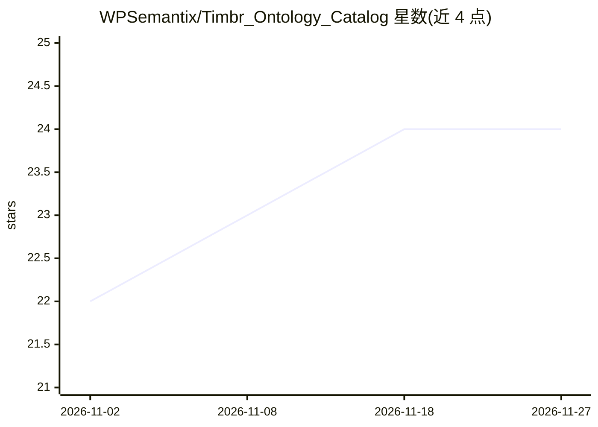

# WPSemantix/Timbr_Ontology_Catalog

⭐ 24 · MIT · 推送 2026-11-01 · [GitHub](https://github.com/WPSemantix/Timbr_Ontology_Catalog) · [官网](https://timbr.ai) · 组织维护

**Timbr 语义层配套的 SQL 本体模板库：32 个领域模型**

由 Timbr 维护的本体目录仓库：收录 32 个领域本体（FIBO、FHIR、供应链、GA4、电信等），以 Timbr SQL 编写，涵盖概念、关系、业务规则、度量与视图。使用流程为在 Timbr 平台创建知识图、执行模型 SQL 脚本、用 CREATE MAPPING 映射到既有数据库表，再从 SQL/BI 工具/AI agent 以虚拟知识图方式查询，数据本身不迁移。本体需配合 Timbr 语义层平台运行，多数模型仅含结构、需自行映射数据。

## 筛选速览

| 维度 | 判定 | 备注 |
|---|---|---|
| AI 角色 | `ai-knowledge` | 知识聚合/清单类 |
| 许可风险 | `permissive` | MIT |
| 部署形态 | `None` |  |
| 模型依赖 | — | README 未给出锁定关系 |
| 硬件要求 | — | 无带数字的原话,不猜 |
| 安装摩擦 | `low` | 无编译、无系统依赖或容器化 |
| 成熟度 | — | 结构信号不足 |

## 能力要点

- 32 个领域本体，概念数量 7–136 不等
- 以关系遍历语法替代手写 JOIN，支持图算法（PageRank/Louvain）
- 通过 Timbr MCP Server 接入 Claude/ChatGPT/Cursor 等 MCP 客户端
- 提供 LangChain/LangGraph SDK 与 Python 连接器、REST、JDBC/ODBC

## 适用场景

- 为企业数据搭建语义层时直接复用领域本体模板
- 通过 MCP 让 LLM 与 agent 以受治理语义查询数据库
- 在 BI 工具中以知识图方式查询数仓/湖仓数据

## 场景标签

`知识图谱` · 领域:知识与检索

## 证据(README 行号)

> L9: **Ready-to-use SQL ontologies for the Timbr semantic layer, the governed enterprise context layer for AI.**
> L31: This repository is a library of **32 domain ontologies** written in Timbr SQL, from FIBO and FHIR to Supply Chain, 
> L46: |**AI-ready context**|Give LLMs and agents governed, deterministic context through MCP and SDKs.|

## 星数曲线

2026-11-02 22 → 2026-11-27 24（+2）

---
*卡片 v1 · prompt 1.4 · 生成 2026-11-18 · 置信度 high · 依据 README sha `dce577e34ac2` · [字段定义](../../DATASET.md)*
