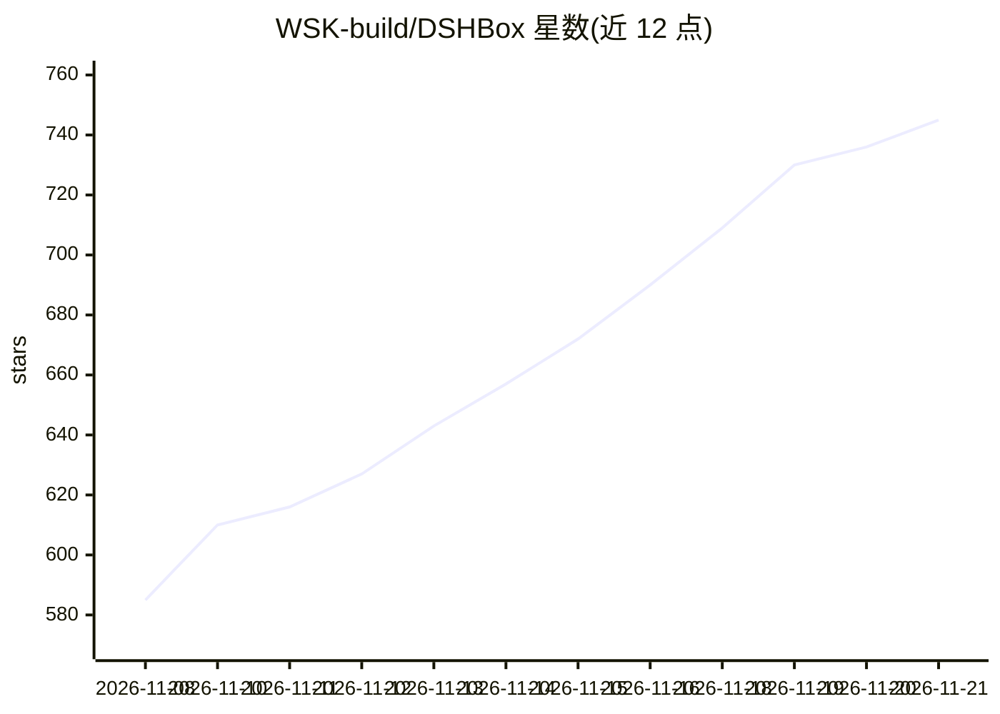

# WSK-build/DSHBox

⭐ 745 · Kotlin · GPL-3.0 · 推送 2026-11-16 · [GitHub](https://github.com/WSK-build/DSHBox) · [官网](https://wsk-build.github.io/DSHBox/) · 组织维护 · 中文 README

**安卓上本地运行或远程连接 DeepSeek Harness 的随身 AI 工作台**

Android 开源应用，以 PRoot+Debian 沙箱内嵌 Node.js 与 DeepSeek Harness 0.2.2-rc.2 实现本地运行，或通过扫码/配对链接远程连接局域网/公网上的 DSH。配套终端、文件管理器（含通用查看/编辑器）、24 项工具的内嵌自动化浏览器、40 项手机操控能力（无障碍/Shizuku/平台直连）及插件市场。免 Root 与 Termux，需 Android 10+ ARM64；提供系统 WebView 版与内置 GeckoView 158 两种 APK。复杂跨页面任务与部分站点兼容场景仍待完善。

## 筛选速览

| 维度 | 判定 | 备注 |
|---|---|---|
| AI 角色 | `ai-ecosystem` | LLM/agent 周边工具 |
| 许可风险 | `viral` | GPL-3.0 |
| 部署形态 | `library` | 以包/库形式分发 |
| 模型依赖 | locked-api |  |
| 硬件要求 | — | 无带数字的原话,不猜 |
| 安装摩擦 | `low` | 无编译、无系统依赖或容器化 |
| 成熟度 | `idea` | |

## 能力要点

- PRoot+Debian 沙箱本地内嵌运行 DSH 0.2.2-rc.2，DSH 源码零修改
- 内嵌 AI 自动化浏览器开放 24 项工具、手机操控 40 项普通能力 + 可选 Shizuku 特权
- 双渲染：系统 WebView 版与内置 GeckoView 158 版可互相覆盖安装
- 插件市场内置两大数据源，内置 pnpm 11.1.2 支持多镜像源探测

## 适用场景

- 在手机/平板上免 Root 本地运行 DeepSeek Harness
- 扫码连接并管理电脑或其他设备上的多个 DSH 实例
- 让 AI 通过浏览器与手机操控能力代为执行任务
- 在移动端管理 DSH 插件与终端环境

## 场景标签

`AI 助手` `浏览器自动化` `GUI 自动化` · 领域:效率与自动化

## 证据(README 行号)

> L16: **DSHBox** is an open-source mobile app for **DeepSeek Harness (DSH)**. It can run DSH locally on your phone or tab
> L27: |本地运行|在移动端装配 PRoot + Debian 沙箱，内置 Node.js 与 DSH `0.2.2-rc.2` 运行层，本地运行 DSH|

## 星数曲线

2026-11-08 585 → 2026-11-21 745（+160）

---
*卡片 v1 · prompt 1.4 · 生成 2026-11-17 · 置信度 mid · 依据 README sha `61eb05c5b5ad` · [字段定义](../../DATASET.md)*
