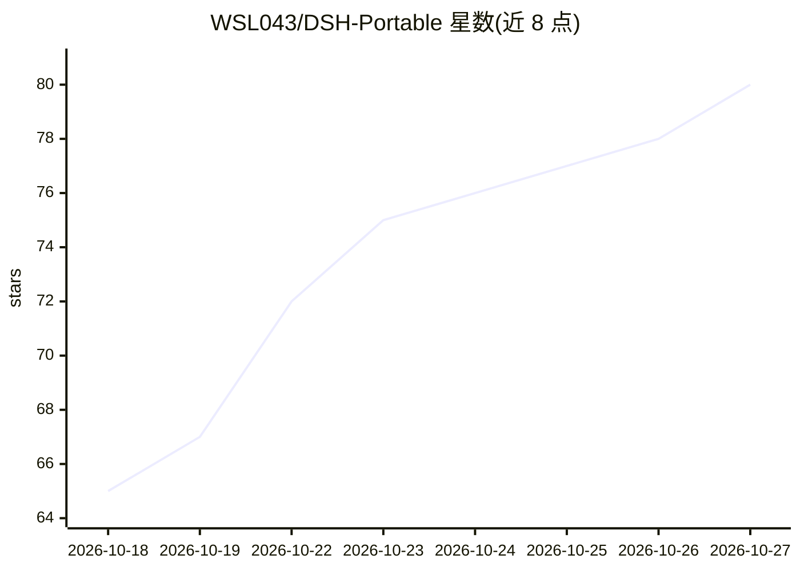

# WSL043/DSH-Portable

⭐ 80 · JavaScript · Apache-2.0 · 推送 2026-10-26 · [GitHub](https://github.com/WSL043/DSH-Portable) · [官网](https://wsl043.github.io/DSH-Portable/) · 个人维护 · 中文 README

**DeepSeek Harness 便携版：一个文件夹携带会话与设置的桌面客户端**

独立社区维护的 DeepSeek Harness 桌面客户端便携发行版：会话、设置、插件和默认工作区集中在一个文件夹内，完全退出后可整夹复制到 U 盘或同平台另一台电脑，不安装、不改系统 PATH。支持 Windows（在线启动器/标准 ZIP/离线 ZIP）、macOS（arm64/x64）与 Linux（AppImage/完整目录）。Portable 与官方内核分开更新，最多 5 个已验证内核版本可选；1.0 线为仅 Windows 的 alpha 预览，基于官方桌面端做纯便携化。登录凭据以明文文件保存在 data 目录，无额外加密。

## 筛选速览

| 维度 | 判定 | 备注 |
|---|---|---|
| AI 角色 | `ai-ecosystem` | LLM/agent 周边工具 |
| 许可风险 | `permissive` | Apache-2.0 |
| 部署形态 | `desktop` | 安装包/桌面程序 |
| 模型依赖 | locked-api |  |
| 硬件要求 | — | 无带数字的原话,不猜 |
| 安装摩擦 | `low` | 无编译、无系统依赖或容器化 |
| 成熟度 | `idea` | |

## 能力要点

- 三平台便携发行：文件夹内集中保存会话、设置、插件与工作区
- 内核版本可选（最多 5 个已验证版本），更新与数据分离，可回滚
- 内置 Image Viewer 与 Chat Manager 两个可卸载插件及插件市场
- 提供 DSH-Recovery.exe 恢复工具与构建脚本（Windows/macOS/Linux）

## 适用场景

- 在多台电脑间携带同一套 DeepSeek 会话与设置
- U 盘绿色使用，不在系统留下安装痕迹
- 需要自选内核版本、可控更新与回滚的桌面端用户

## 场景标签

`聊天机器人` · 领域:对话与助手

## 证据(README 行号)

> L5:  DeepSeek Harness 便携版：整个文件夹拷到 U 盘，换一台电脑接着用。
> L26: > DSH-Portable 是独立社区发行版，不是 DeepSeek 官方应用，未获 DeepSeek 背书。
> L72: 3. 连接模型服务；以后运行文件夹里的 DeepSeek-Herness.exe。

## 星数曲线

2026-10-18 65 → 2026-10-27 80（+15）

---
*卡片 v1 · prompt 1.4 · 生成 2026-10-24 · 置信度 high · 依据 README sha `5d0555e5c4d7` · [字段定义](../../DATASET.md)*
