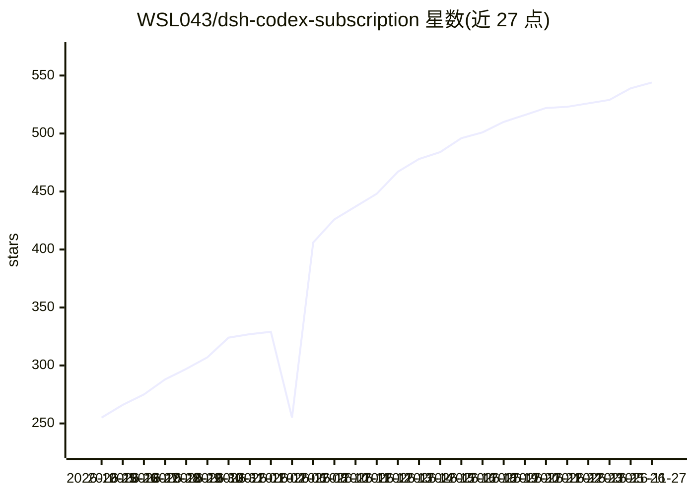

# WSL043/dsh-codex-subscription

⭐ 544 · JavaScript · MIT · 推送 2026-11-26 · [GitHub](https://github.com/WSL043/dsh-codex-subscription) · [官网](https://www.npmjs.com/package/dsh-codex-subscription) · 个人维护 · 中文 README

**在 DSH 中接入 ChatGPT/Codex 订阅的插件**

DeepSeek Harness（DSH）的社区插件：用 ChatGPT Plus/Pro 订阅登录后在 DSH 中调用 Codex 模型，无需 OpenAI API Key 与 Codex CLI。提供模型目录同步、推理/速度档位选择、订阅联网搜索、图片生成与编辑、草图画板与 Agent 绘图、额度查看与提醒、多账号管理，以及通过 ChatGPT 手机 App 远程控制电脑上的 DSH（Beta）。以 npm 包形式随 DSH 插件系统安装，要求账号具备 Codex 访问权限；模型与额度以服务端实际返回为准。

## 筛选速览

| 维度 | 判定 | 备注 |
|---|---|---|
| AI 角色 | `ai-ecosystem` | LLM/agent 周边工具 |
| 许可风险 | `permissive` | MIT |
| 部署形态 | `None` |  |
| 模型依赖 | — | README 未给出锁定关系 |
| 硬件要求 | — | 无带数字的原话,不猜 |
| 安装摩擦 | `low` | 无编译、无系统依赖或容器化 |
| 成熟度 | — | 结构信号不足 |

## 能力要点

- ChatGPT 订阅登录即可在 DSH 使用 Codex 模型，无需 API Key
- 订阅额度详情、去向拆分、续航预测与阈值提醒
- 图片生成、区域标注编辑与草图画板（Beta，支持 Agent 绘图）
- ChatGPT 手机 App 配对远程控制电脑上的 DSH（Beta，默认关闭）

## 适用场景

- 已有 ChatGPT Plus/Pro 订阅，想在 DSH 中直接调用 GPT-6/Codex 模型
- 跟踪订阅额度消耗并及时收到余额提醒
- 在会话中生成和迭代编辑图片、用画板让 Agent 作画
- 通过手机 App 在外出时远程操作电脑上的 DSH 会话

## 场景标签

`图像生成` · 领域:内容生成

## 证据(README 行号)

> L9: 用 ChatGPT Plus / Pro 订阅登录，即可在 DSH 中使用 GPT-6 等 Codex 模型、查额度、联网搜索和生图。无需 OpenAI API Key，也不依赖 Codex CLI。
> L35: 请使用官方 DSH 的兼容版本。插件发布前会验证 DSH 在 npm 上的 `latest` 和 `next` 渠道。可安装的 DSH 版本范围见插件清单中的 `engines.dsh`。
> L66: dsh plugin --profile web add dsh-codex-subscription@3.2.33

## 星数曲线

2026-10-25 255 → 2026-11-27 544（+289）

---
*卡片 v1 · prompt 1.4 · 生成 2026-11-27 · 置信度 high · 依据 README sha `297d8a326da0` · [字段定义](../../DATASET.md)*
