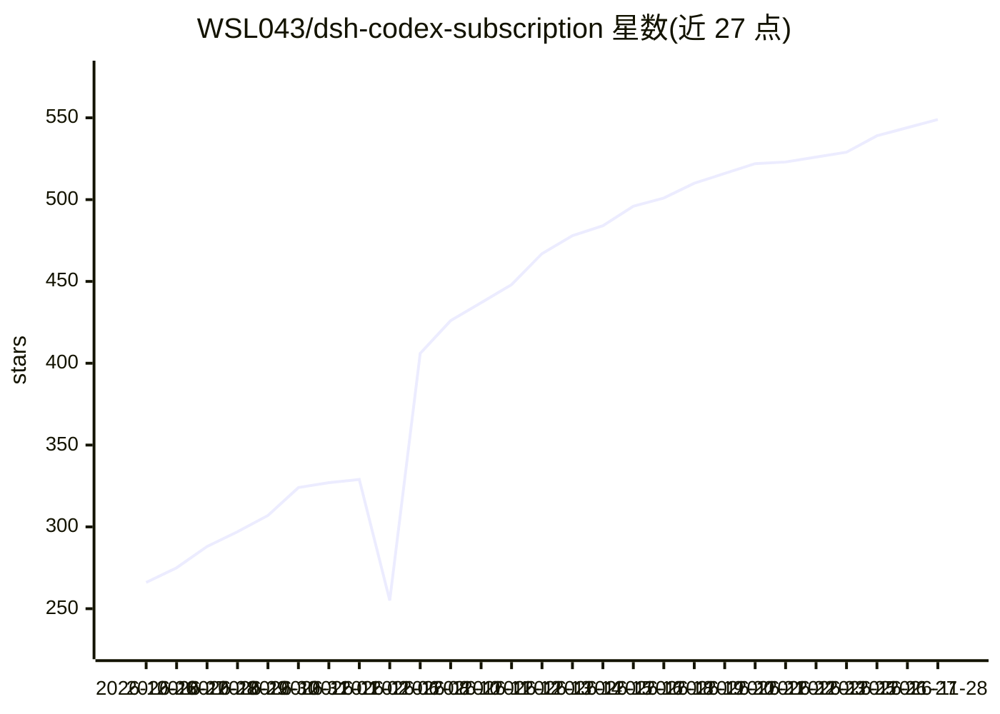

# WSL043/dsh-codex-subscription

⭐ 549 · JavaScript · MIT · 推送 2026-11-27 · [GitHub](https://github.com/WSL043/dsh-codex-subscription) · [官网](https://www.npmjs.com/package/dsh-codex-subscription) · 个人维护 · 中文 README

**让 DSH 用户用 ChatGPT 订阅直接调用 Codex 模型的插件**

DeepSeek Harness（DSH）的社区插件：用户以 ChatGPT Plus/Pro 订阅登录，即可在 DSH 中调用 Codex 模型、订阅联网搜索、图片生成与编辑，无需 OpenAI API Key。提供多账号与额度管理（短周期/每周额度、重置时间、用量拆分、续航预测）、草图画板与 Agent 绘图、ChatGPT 连接器调用已连接应用、以及通过 ChatGPT 手机 App 远程控制电脑上的 DSH（Beta，默认关闭）。模型与功能开放范围以账号实际返回为准；支持 npm/终端/headless 多种安装路径。

## 筛选速览

| 维度 | 判定 | 备注 |
|---|---|---|
| AI 角色 | `ai-ecosystem` | LLM/agent 周边工具 |
| 许可风险 | `permissive` | MIT |
| 部署形态 | `None` |  |
| 模型依赖 | — | README 未给出锁定关系 |
| 硬件要求 | — | 无带数字的原话,不猜 |
| 安装摩擦 | `low` | 无编译、无系统依赖或容器化 |
| 成熟度 | — | 结构信号不足 |

## 能力要点

- ChatGPT 订阅登录即可在 DSH 使用 Codex 模型，无需 API Key
- 多账号额度管理：用量拆分、热力图、阈值提醒与续航预测
- 草图画板与 Agent 绘图（SVG 原生笔画、参考图对比、绘制回放）
- ChatGPT 手机 App 配对远程控制 DSH（Beta，默认关闭）

## 适用场景

- 已有 ChatGPT Plus/Pro 订阅，想在 DSH 中使用 Codex 模型
- 在同一界面管理多个 ChatGPT 账号的额度与用量
- 用订阅出图并在草图画板上让 Agent 继续绘制
- 出门后用手机 App 继续操作电脑上运行的 DSH

## 场景标签

`图像生成` · 领域:内容生成

## 证据(README 行号)

> L7: **把 ChatGPT / Codex 订阅直接接入 DeepSeek Harness**
> L9: 用 ChatGPT Plus / Pro 订阅登录，即可在 DSH 中使用 GPT-6 等 Codex 模型、查额度、联网搜索和生图。无需 OpenAI API Key，也不依赖 Codex CLI。
> L35: 请使用官方 DSH 的兼容版本。插件发布前会验证 DSH 在 npm 上的 `latest` 和 `next` 渠道。可安装的 DSH 版本范围见插件清单中的 `engines.dsh`。

## 星数曲线

2026-10-26 266 → 2026-11-28 549（+283）

---
*卡片 v1 · prompt 1.4 · 生成 2026-11-28 · 置信度 high · 依据 README sha `987cecaba226` · [字段定义](../../DATASET.md)*
