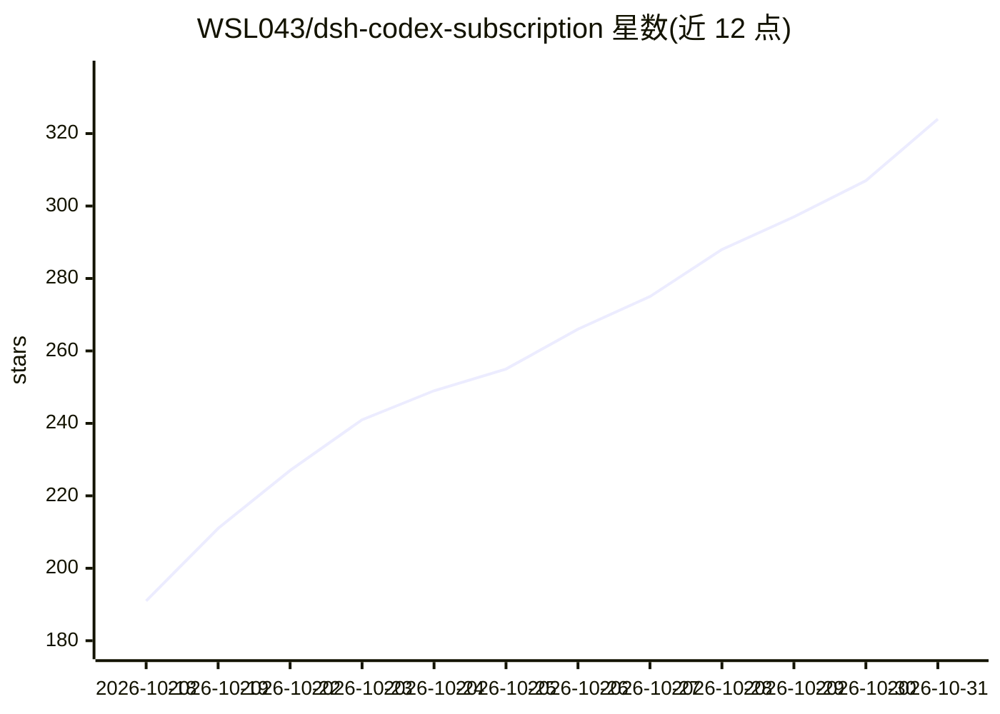

# WSL043/dsh-codex-subscription

⭐ 324 · JavaScript · MIT · 推送 2026-10-30 · [GitHub](https://github.com/WSL043/dsh-codex-subscription) · [官网](https://www.npmjs.com/package/dsh-codex-subscription) · 个人维护 · 中文 README

**让 DSH 使用 ChatGPT/Codex 订阅的插件：模型、额度、生图、远程控制**

面向 DeepSeek Harness（DSH）的社区插件：用 ChatGPT Plus / Pro 订阅扫码登录后，在 DSH 中直接选用 GPT-6 等 Codex 订阅模型，无需 OpenAI API Key，也不依赖 Codex CLI。功能覆盖订阅额度查看与提醒、订阅联网搜索、订阅图片生成与草图画板、ChatGPT 连接器，以及用 ChatGPT 手机 App 扫码远程控制电脑上的 DSH（Beta，默认关闭）。通过 DSH 插件页或 dsh plugin 命令安装；需 DSH 0.1.7-rc.2 以上且账号具有 Codex 使用资格。手机远程控制基于 Codex Remote Control 协议的第三方主机接入，非官方明确支持范围。

## 筛选速览

| 维度 | 判定 | 备注 |
|---|---|---|
| AI 角色 | `ai-ecosystem` | LLM/agent 周边工具 |
| 许可风险 | `permissive` | MIT |
| 部署形态 | `None` |  |
| 模型依赖 | — | README 未给出锁定关系 |
| 硬件要求 | — | 无带数字的原话,不猜 |
| 安装摩擦 | `low` | 无编译、无系统依赖或容器化 |
| 成熟度 | `idea` | |

## 能力要点

- 订阅登录后直接使用 Codex 订阅模型，无需 API Key 与 Codex CLI
- 额度卡片：短周期/每周额度、重置时间、额度去向拆分与每日热力图
- ChatGPT 手机 App 扫码远程控制电脑上的 DSH（Beta，默认关闭）
- 订阅图片生成、区域标注编辑与草图画板（含 Agent 绘图，Beta）

## 适用场景

- 已有 ChatGPT Plus/Pro 订阅，想在 DSH 里直接用 Codex 模型而不买 API
- 在输入框里随时查看订阅剩余额度并在低量时收到提醒
- 用手机上的 ChatGPT App 远程操控电脑上的 DSH 会话
- 让 DSH 中的模型调用 ChatGPT 里已连接的 GitHub、Gmail 等应用

## 场景标签

`图像生成` · 领域:内容生成

## 证据(README 行号)

> L9: 用 ChatGPT Plus / Pro 订阅登录，即可在 DSH 中使用 GPT-6 等 Codex 模型、查额度、联网搜索和生图。无需 OpenAI API Key，也不依赖 Codex CLI。
> L27: 本插件支持软件包元数据中记录的最新版 DeepSeek Harness，并需要一个当前具有 Codex 使用资格的 ChatGPT 账户。
> L29: - **推荐：官方桌面端**。DeepSeek 已发布 DeepSeek Harness 桌面版（macOS Apple Silicon、Windows 64 位，预览版、开源），无需配置 Node.js，安装后按下文在插件页面添

## 星数曲线

2026-10-18 191 → 2026-10-31 324（+133）

---
*卡片 v1 · prompt 1.4 · 生成 2026-10-22 · 置信度 high · 依据 README sha `229b40d69d45` · [字段定义](../../DATASET.md)*
