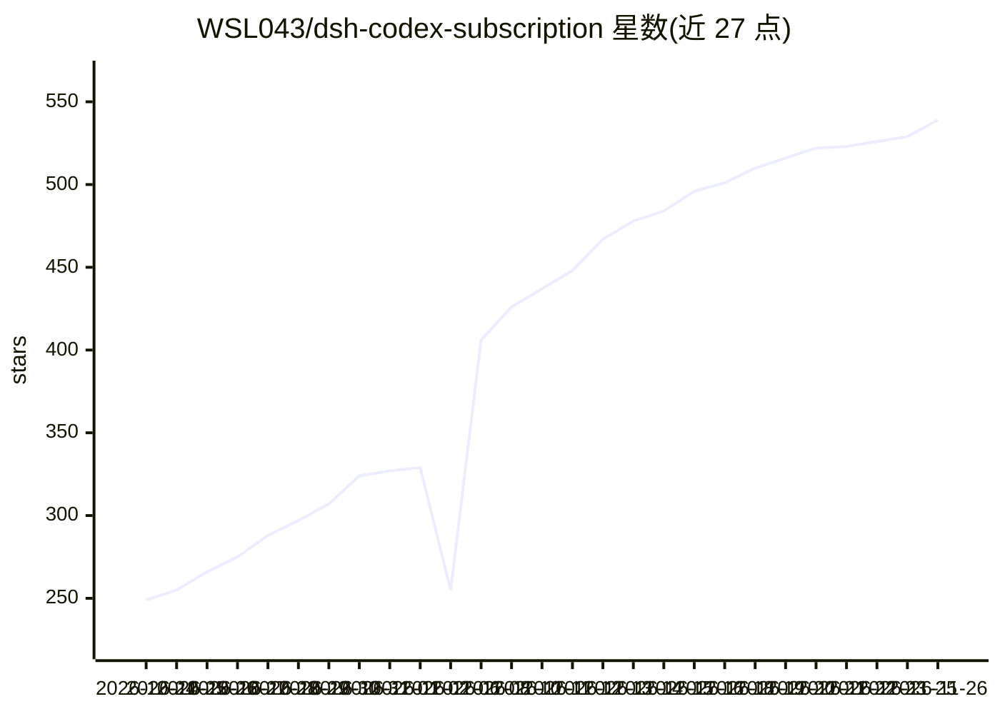

# WSL043/dsh-codex-subscription

⭐ 539 · JavaScript · MIT · 推送 2026-11-25 · [GitHub](https://github.com/WSL043/dsh-codex-subscription) · [官网](https://www.npmjs.com/package/dsh-codex-subscription) · 个人维护 · 中文 README

**DSH 插件：用 ChatGPT 订阅登录使用 Codex 模型与额度**

面向 DeepSeek Harness（DSH）的社区插件，通过 ChatGPT Plus / Pro 订阅登录接入 Codex 模型，无需 OpenAI API Key，也不依赖 Codex CLI（仅独立子任务需准备 CLI）。功能包括模型目录同步与推理/速度档位选择、额度查看与提醒、订阅联网搜索、图片生成与可编辑草图画板、ChatGPT 连接器复用、以及通过 ChatGPT 手机 App 远程控制电脑上的 DSH（Beta，默认关闭）。模型、额度以账号实际返回为准；请求失败明确报错，不静默切换付费路由。发布前用 DSH 官方 latest/next 渠道做端到端验收。

## 筛选速览

| 维度 | 判定 | 备注 |
|---|---|---|
| AI 角色 | `ai-ecosystem` | LLM/agent 周边工具 |
| 许可风险 | `permissive` | MIT |
| 部署形态 | `None` |  |
| 模型依赖 | — | README 未给出锁定关系 |
| 硬件要求 | — | 无带数字的原话,不猜 |
| 安装摩擦 | `low` | 无编译、无系统依赖或容器化 |
| 成熟度 | — | 结构信号不足 |

## 能力要点

- 订阅登录使用 Codex 模型，无需 API Key；支持多账号、额度详情与提醒
- 图片生成、区域标注编辑与支持 SVG 笔画的草图画板（Beta，默认关闭）
- ChatGPT 手机 App 配对远程控制电脑上的 DSH（Beta）
- 模型目录按账号缓存 24 小时，未登录且无缓存时不显示任何模型

## 适用场景

- 已有 ChatGPT Plus/Pro 订阅，想在 DSH 里直接用 Codex 模型
- 在会话中实时查看和管理订阅额度与用量
- 用订阅生成和编辑图片、在草图画板上让 Agent 作画
- 出门时用手机 App 继续操作电脑上运行的 DSH

## 场景标签

`图像生成` `模型网关` · 领域:Agent 开发

## 证据(README 行号)

> L9: 用 ChatGPT Plus / Pro 订阅登录，即可在 DSH 中使用 GPT-6 等 Codex 模型、查额度、联网搜索和生图。无需 OpenAI API Key，也不依赖 Codex CLI。
> L35: 请使用官方 DSH 的兼容版本。插件发布前会验证 DSH 在 npm 上的 `latest` 和 `next` 渠道。可安装的 DSH 版本范围见插件清单中的 `engines.dsh`。
> L292: - **只做 ChatGPT / Codex 订阅**，并把这一件事做深：额度与预测、图片与草图、子任务、诊断；不接入 Claude、Grok 等其他订阅。

## 星数曲线

2026-10-24 249 → 2026-11-26 539（+290）

---
*卡片 v1 · prompt 1.4 · 生成 2026-11-26 · 置信度 high · 依据 README sha `6f9326095222` · [字段定义](../../DATASET.md)*
