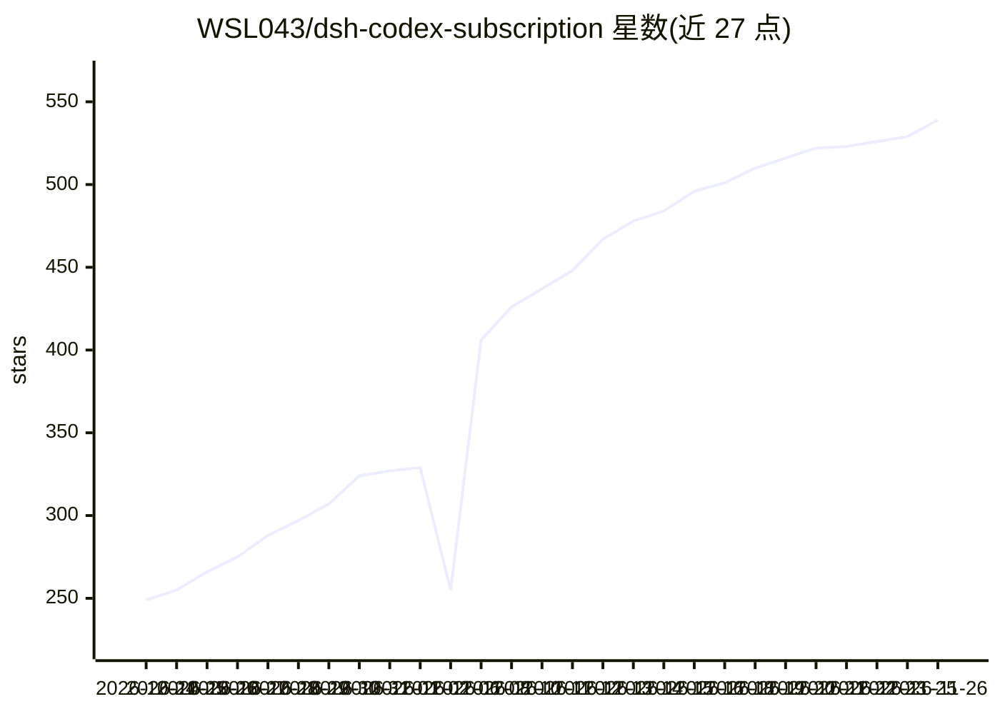

# WSL043/dsh-codex-subscription

⭐ 539 · JavaScript · MIT · 推送 2026-11-25 · [GitHub](https://github.com/WSL043/dsh-codex-subscription) · [官网](https://www.npmjs.com/package/dsh-codex-subscription) · 个人维护 · 中文 README

**在 DSH 中用 ChatGPT 订阅调用 Codex 模型的插件**

DeepSeek Harness（DSH）的社区插件，通过 ChatGPT Plus/Pro 订阅浏览器登录，在 DSH 中使用账号开放的 Codex 模型、联网搜索、图片生成与编辑，无需 OpenAI API Key。提供多账号与额度管理、额度提醒与续航预测、输入预测、草图画板与 Agent 绘图、Codex 独立子任务、ChatGPT 连接器，以及通过 ChatGPT 手机 App 远程控制电脑上的 DSH（Beta）。模型与额度以账号实际返回为准；请求失败明确报错，不切换其他付费路由。安装依赖已运行的 DSH 宿主。

## 筛选速览

| 维度 | 判定 | 备注 |
|---|---|---|
| AI 角色 | `ai-ecosystem` | LLM/agent 周边工具 |
| 许可风险 | `permissive` | MIT |
| 部署形态 | `None` |  |
| 模型依赖 | — | README 未给出锁定关系 |
| 硬件要求 | — | 无带数字的原话,不猜 |
| 安装摩擦 | `low` | 无编译、无系统依赖或容器化 |
| 成熟度 | — | 结构信号不足 |

## 能力要点

- 订阅登录使用 Codex 模型与订阅联网搜索，无需 API Key
- 多账号切换、短周期/每周额度查看、额度提醒与续航预测
- 图片生成与区域标注编辑，草图画板支持 Agent 以 SVG 笔画绘图
- ChatGPT 手机 App 配对远程控制电脑上的 DSH（Beta，默认关闭）

## 适用场景

- 已有 ChatGPT Plus/Pro 订阅，想在 DSH 中直接使用 Codex 模型
- 在会话中查看和管理订阅额度与用量
- 用手机 App 远程操作电脑上正在运行的 DSH
- 让 DSH 中的模型使用 ChatGPT 已连接的 GitHub、Gmail 等应用

## 场景标签

`图像生成` `编码 Agent` · 领域:编码与开发

## 证据(README 行号)

> L9: 用 ChatGPT Plus / Pro 订阅登录，即可在 DSH 中使用 GPT-6 等 Codex 模型、查额度、联网搜索和生图。无需 OpenAI API Key，也不依赖 Codex CLI。
> L35: 请使用官方 DSH 的兼容版本。插件发布前会验证 DSH 在 npm 上的 `latest` 和 `next` 渠道。可安装的 DSH 版本范围见插件清单中的 `engines.dsh`。
> L242: 会话、工具审批和工作区权限由 DSH 管理。订阅插件提供 Codex 请求路径，以及上面介绍的设置和工具。排查功能为什么不可用时，先核对 DSH 版本、账号能力、当前模型和设置，再追踪相关工具或请求。

## 星数曲线

2026-10-24 249 → 2026-11-26 539（+290）

---
*卡片 v1 · prompt 1.4 · 生成 2026-11-25 · 置信度 high · 依据 README sha `499402f536e7` · [字段定义](../../DATASET.md)*
