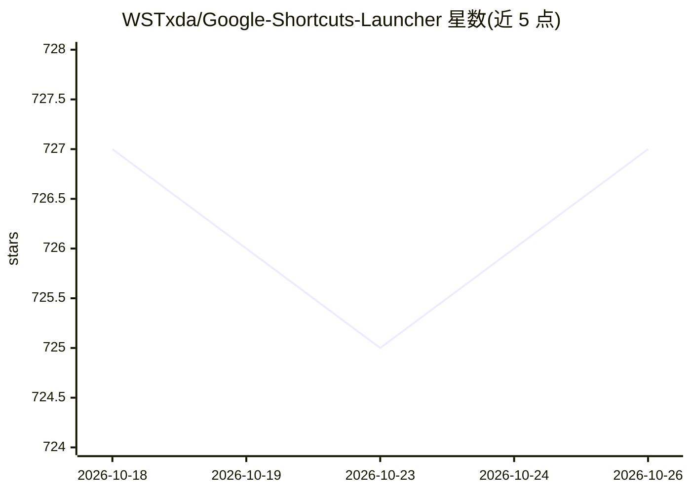

# WSTxda/Google-Shortcuts-Launcher

⭐ 727 · Kotlin · GPL-3.0 · 推送 2026-10-01 · [GitHub](https://github.com/WSTxda/Google-Shortcuts-Launcher) · 个人维护

**在 Android 抽屉中直达 Google 应用功能的快捷方式集合**

Android 应用，提供约 18 个快捷方式，从启动器应用抽屉直接调用 Google 及系统功能：语音助手（Gemini/Bixby 等）、条码/二维码扫描、Chrome 无痕标签、AOSP 文件管理、Google Lens 视觉搜索、音乐识别、密码管理器、Quick Share、天气与搜索等。各快捷方式依赖对应应用（Google App、Chrome、Play Services 等），部分需 Shizuku 打开非导出 Activity。通过 GitHub Release 与 Telegram 渠道分发安装包。本体是快捷方式启动工具，AI 能力（助手、Lens）仅为被调用的外部功能。

## 筛选速览

| 维度 | 判定 | 备注 |
|---|---|---|
| AI 角色 | `ai-enhanced` | 去掉 AI 部分产品仍成立 |
| 许可风险 | `viral` | GPL-3.0 |
| 部署形态 | `None` |  |
| 模型依赖 | — | README 未给出锁定关系 |
| 硬件要求 | — | 无带数字的原话,不猜 |
| 安装摩擦 | `low` | 无编译、无系统依赖或容器化 |
| 成熟度 | — | 结构信号不足 |

## 能力要点

- 约 18 个覆盖 Google 与系统功能的快捷方式
- 支持调用设备默认语音助手（如 Gemini、Bixby）
- 部分快捷方式通过 Shizuku 打开非导出 Activity
- 以 GitHub Release 与 Telegram 渠道分发

## 适用场景

- 把常用的 Google 功能固定到应用抽屉一键直达
- 快速唤起 Google Lens、条码扫描等工具型功能
- 不打开浏览器即可访问天气、金融、购物等服务

## 场景标签

 · 领域:移动应用/效率工具

## 证据(README 行号)

> L20: #### Assistant
> L90: > **Required Apps:** The Google app, Google Chrome, Google Play Services, Google Play and Google Play Games must be

## 星数曲线

2026-10-18 727 → 2026-10-26 727（+0）

---
*卡片 v1 · prompt 1.4 · 生成 2026-10-21 · 置信度 high · 依据 README sha `b9d5444d71f5` · [字段定义](../../DATASET.md)*
