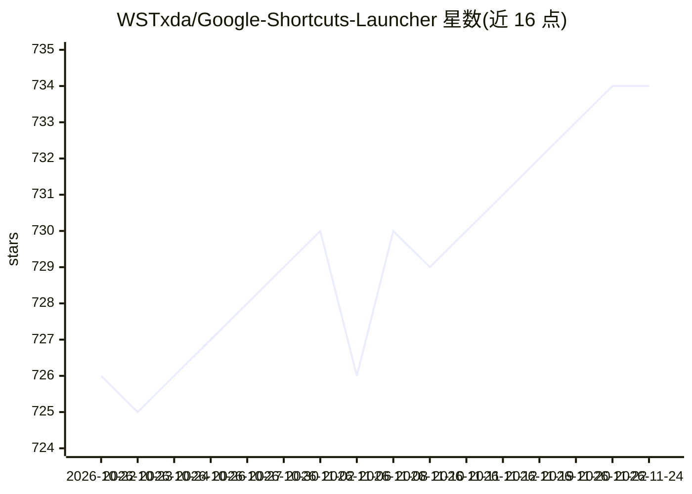

# WSTxda/Google-Shortcuts-Launcher

⭐ — · [GitHub]() · 个人维护

**在启动器抽屉中直达 Google 应用功能的快捷方式合集**

Android 应用，向系统启动器应用抽屉注入一组快捷方式，调用设备上已安装的 Google 应用与服务：语音助手、条码扫描、Chrome 无痕标签、文件管理器、Google Lens、音乐识别、密码管理器、Quick Share、游戏启动器等十余项。多数快捷方式依赖 Google 应用、Chrome、Play Services 等已安装；部分需 Shizuku 打开未导出的 activity。发布渠道为 GitHub 与 Telegram 提供的 APK。

## 筛选速览

| 维度 | 判定 | 备注 |
|---|---|---|
| AI 角色 | `ai-enhanced` | 去掉 AI 部分产品仍成立 |
| 许可风险 | `viral` | — |
| 部署形态 | `None` |  |
| 模型依赖 | — | README 未给出锁定关系 |
| 硬件要求 | — | 无带数字的原话,不猜 |
| 安装摩擦 | `low` | 无编译、无系统依赖或容器化 |
| 成熟度 | — | 结构信号不足 |

## 能力要点

- 提供 Assistant、Lens、条码扫描、音乐识别等十余项快捷方式
- 多数快捷方式依赖设备已装的 Google 应用与 Play Services
- 部分快捷方式通过 Shizuku 打开非导出 activity
- 通过 GitHub 与 Telegram 渠道分发

## 适用场景

- 从启动器抽屉快速打开 Google Lens 或音乐识别
- 一键进入 Chrome 无痕浏览会话
- 快速访问 Google 密码管理器与 Passkey 列表

## 场景标签

 · 领域:Android 工具/桌面效率

## 证据(README 行号)

> L13: Google Shortcuts Launcher provides a seamless way to integrate powerful Google services into your daily workflow. W
> L21: #### Assistant
> L22: Quickly invoke your device’s voice assistant—such as Gemini, Bixby, or others—to streamline tasks and access smart 

## 星数曲线

2026-10-22 726 → 2026-11-24 734（+8）

---
*卡片 v1 · prompt 1.4 · 生成 2026-11-24 · 置信度 high · 依据 README sha `68a7b0ac5968` · [字段定义](../../DATASET.md)*
