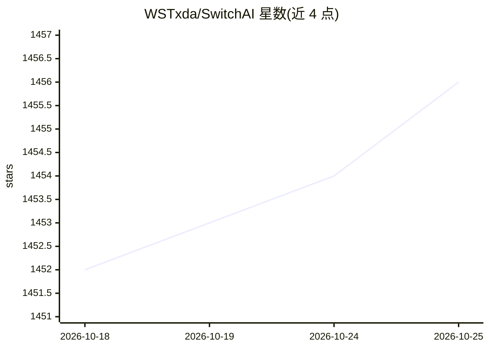

# WSTxda/SwitchAI

⭐ 1,457 · Kotlin · GPL-3.0 · 推送 2026-10-17 · [GitHub](https://github.com/WSTxda/SwitchAI) · 个人维护

**安卓上一键切换、启动与管理 AI 语音助手的应用**

Android 应用，用于选择、启动和管理设备上已安装的 AI 数字助手：可单次切换或设为系统默认助手，触发系统助手功能时弹出选择器，支持语音免手操作，并提供主屏幕小组件与快捷设置磁贴。兼容 40+ 款助手应用（ChatGPT、Claude、DeepSeek、Gemini 等），通过包名与类名拉起目标应用，应用需自行安装。界面采用 Material 3 Expressive 设计，为 Plugin-VoiceGPT 的延续项目。

## 筛选速览

| 维度 | 判定 | 备注 |
|---|---|---|
| AI 角色 | `ai-ecosystem` | LLM/agent 周边工具 |
| 许可风险 | `viral` | GPL-3.0 |
| 部署形态 | `None` |  |
| 模型依赖 | — | README 未给出锁定关系 |
| 硬件要求 | — | 无带数字的原话,不猜 |
| 安装摩擦 | `low` | 无编译、无系统依赖或容器化 |
| 成熟度 | — | 结构信号不足 |

## 能力要点

- 单次切换或设置系统默认 AI 助手
- 支持 40+ 款助手应用，通过包名与类名拉起
- 主屏幕小组件与快捷设置磁贴快速启动
- Material 3 Expressive 设计，FOSS

## 适用场景

- 在多个 AI 助手应用之间快速切换使用
- 把喜欢的 AI 助手设为系统默认语音入口
- 通过小组件一键唤起助手或选择器

## 场景标签

 · 领域:移动应用/Android 工具

## 证据(README 行号)

> L13: SwitchAI is an Android application that lets you easily select, start, and manage your preferred AI digital assista
> L34: Supports 40+ popular AI assistant apps including ChatGPT, Claude, DeepSeek, Gemini, and many more.

## 星数曲线

2026-10-18 1,452 → 2026-10-25 1,456（+4）

---
*卡片 v1 · prompt 1.4 · 生成 2026-10-21 · 置信度 high · 依据 README sha `c5778b3dfcd1` · [字段定义](../../DATASET.md)*
