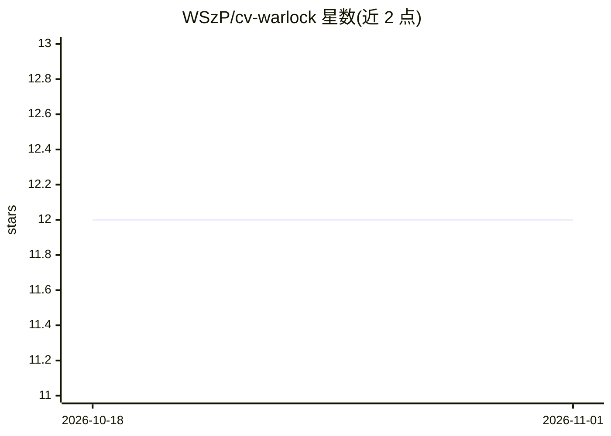

# WSzP/cv-warlock

⭐ 12 · Python · Apache-2.0 · 推送 2026-10-31 · [GitHub](https://github.com/WSzP/cv-warlock) · 个人维护

**按职位定制简历并模拟 ATS 评分的 LLM 工具**

输入通用简历与职位描述，通过 LangGraph 多阶段工作流（提取→分析→规划→改写→组装）生成强调相关经历的定制简历，并给出匹配度分析与可迁移技能。默认启用 RLM（递归语言模型）模式，用 REPL 沙箱与子调用处理超长文本，超过 8K 字符才启用、可关闭。支持 OpenAI、Anthropic、Gemini 三类 API key（至少需一个），提供 CLI 与 Streamlit Web UI，另带 Markdown 转 PDF 功能。README 声明仅供研究娱乐，不建议用于真实求职申请。

## 筛选速览

| 维度 | 判定 | 备注 |
|---|---|---|
| AI 角色 | `ai-native` | 本体是模型或模型工具 |
| 许可风险 | `permissive` | Apache-2.0 |
| 部署形态 | `None` |  |
| 模型依赖 | locked-api |  |
| 硬件要求 | — | 无带数字的原话,不猜 |
| 安装摩擦 | `low` | 无编译、无系统依赖或容器化 |
| 成熟度 | `idea` | |

## 能力要点

- LangGraph 工作流：提取/分析/规划/改写/组装五阶段
- RLM 递归编排处理超长简历与职位描述，可 CLI/环境变量关闭
- 多 Provider 支持：OpenAI、Anthropic Claude、Google Gemini
- Markdown 转 PDF（Modern/Plain 两种样式）

## 适用场景

- 把通用简历按目标职位描述生成定制版本
- 查看简历与职位的匹配度、差距与可迁移技能
- 将 Markdown 简历转换为 ATS 友好的 PDF

## 场景标签

`AI 写作` · 领域:内容生成

## 证据(README 行号)

> L19: **RLM-powered CV tailoring for job applications.** Takes your generic CV and a job posting, then uses Recursive Lan
> L35: - **Smart CV Tailoring**: Analyzes job requirements and rewrites your CV to highlight relevant experience
> L40: - **Multi-Provider LLM Support**: Works with OpenAI, Anthropic Claude, and Google Gemini

## 星数曲线

2026-10-18 12 → 2026-11-01 12（+0）

---
*卡片 v1 · prompt 1.4 · 生成 2026-11-01 · 置信度 high · 依据 README sha `91eae8e0baac` · [字段定义](../../DATASET.md)*
