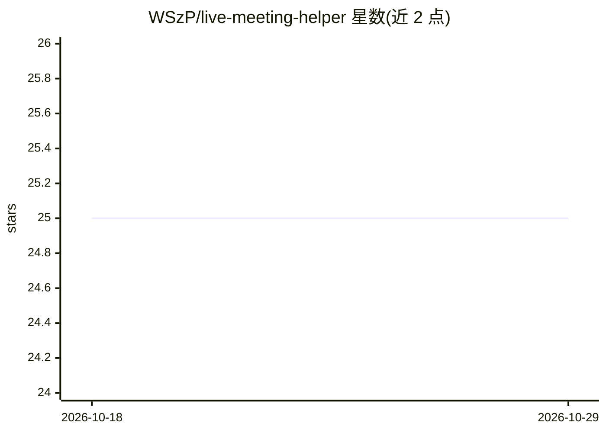

# WSzP/live-meeting-helper

⭐ 25 · TypeScript · Apache-2.0 · 推送 2026-04-16 · [GitHub](https://github.com/WSzP/live-meeting-helper) · 个人维护

**实时会议转录与 AI 助手：转写语音并向 Gemini 提问摘要**

基于 Next.js 16 与 Node.js WebSocket 服务的网页应用：浏览器采集麦克风音频，每 250ms 经 WebSocket 推流至服务器，调用 Google Cloud Speech-to-Text 流式 API 实时转写（含中间结果与自动标点），并可将转写文本发送给 Google Gemini（经 LangChain 接入）生成会议摘要与问答，回答流式返回，支持导出转写文本。运行需 Node.js 20+、pnpm 10+、Google Cloud 账号与 Google AI API key。限制：单流约 305 秒需自动重启、仅配置 en-US、需支持 MediaRecorder 的现代浏览器。

## 筛选速览

| 维度 | 判定 | 备注 |
|---|---|---|
| AI 角色 | `ai-native` | 本体是模型或模型工具 |
| 许可风险 | `permissive` | Apache-2.0 |
| 部署形态 | `library` | 以包/库形式分发 |
| 模型依赖 | — | README 未给出锁定关系 |
| 硬件要求 | — | 无带数字的原话,不猜 |
| 安装摩擦 | `low` | 无编译、无系统依赖或容器化 |
| 成熟度 | — | 结构信号不足 |

## 能力要点

- WebSocket 低延迟音频流式转写（Google Cloud Speech-to-Text 流式 API）
- Gemini 驱动的会议问答与自动摘要，回答流式返回
- 转写文本导出下载、麦克风测试与音量监控
- 长会议自动重启音频流以绕过约 305 秒单流限制

## 适用场景

- 线上或线下会议中实时查看英文转写文字
- 会后向 AI 询问会议要点或生成摘要
- 导出转写文本留档

## 场景标签

`语音识别` `AI 写作` `聊天机器人` · 领域:对话与助手

## 证据(README 行号)

> L12: **Real-time meeting transcription with AI-powered insights.** Captures live audio from your microphone, transcribes
> L34: |**AI Assistant**|Google Gemini via LangChain|
> L115: 5. **AI Processing**: When requested, transcript is sent to Gemini (gemini-3-flash-preview) via LangChain, with re

## 星数曲线

2026-10-18 25 → 2026-10-29 25（+0）

---
*卡片 v1 · prompt 1.4 · 生成 2026-10-27 · 置信度 mid · 依据 README sha `685b6507c3f5` · [字段定义](../../DATASET.md)*
