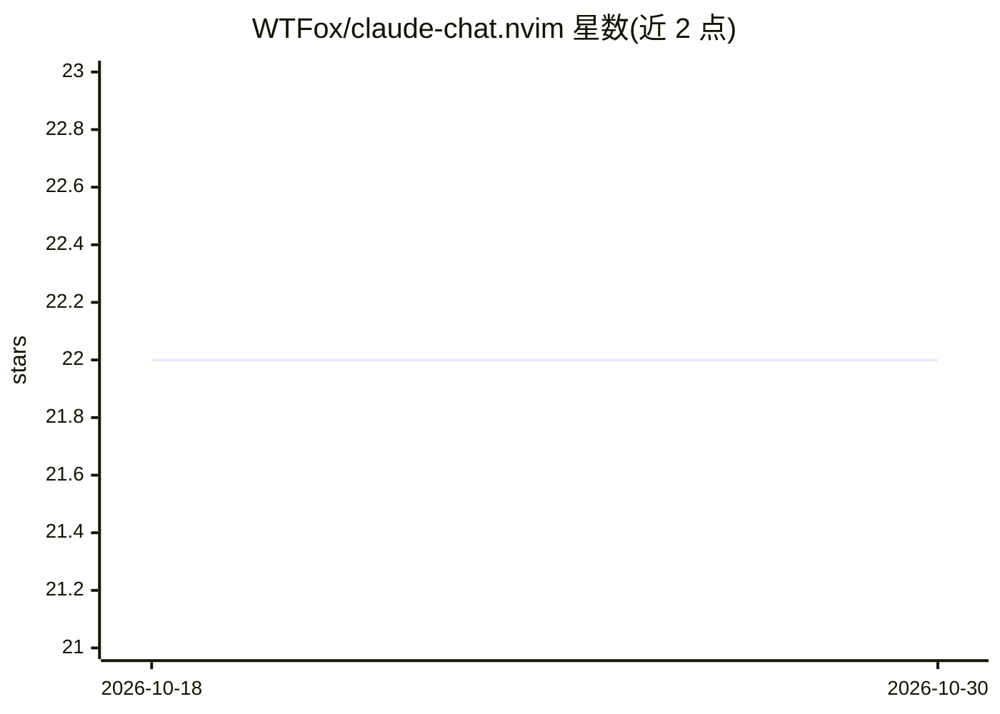

# WTFox/claude-chat.nvim

⭐ 22 · Lua · 推送 2026-03-27 · [GitHub](https://github.com/WTFox/claude-chat.nvim) · [官网](https://www.afox.dev/posts/claude-chat-nvim) · 个人维护

**在 Neovim 中包装 Claude Code CLI 的对话插件**

Neovim 插件，封装 Claude Code CLI 的调用流程：自动收集当前文件路径、filetype 与选区文本作为上下文，在可配置的分屏或浮动窗口中启动 Claude 终端；对可见缓冲区的修改实时反映到 Neovim。提供 :ClaudeChat 命令、终端快捷键与窗口切换逻辑，不修改 Claude 自身配置。要求 Neovim 0.7+ 且 PATH 中有 claude 命令，通过 lazy.nvim、vim-plug、packer.nvim 等插件管理器安装，MIT 许可。

## 筛选速览

| 维度 | 判定 | 备注 |
|---|---|---|
| AI 角色 | `ai-ecosystem` | LLM/agent 周边工具 |
| 许可风险 | `none` | — |
| 部署形态 | `None` |  |
| 模型依赖 | — | README 未给出锁定关系 |
| 硬件要求 | — | 无带数字的原话,不猜 |
| 安装摩擦 | `low` | 无编译、无系统依赖或容器化 |
| 成熟度 | — | 结构信号不足 |

## 能力要点

- 自动传递当前文件路径、filetype 与选区文本作为上下文
- 分屏/浮动窗口中的交互式 Claude 终端与快捷键
- 缓冲区文件变更实时反映
- 支持 lazy.nvim/vim-plug/packer.nvim 安装与窗口行为配置

## 适用场景

- 在 Neovim 中直接对当前文件或选区提问 Claude
- 编码时快速唤出/隐藏 Claude 对话窗口
- 发送定向指令让 Claude 分析或修改代码

## 场景标签

`编码 Agent` · 领域:编码与开发

## 证据(README 行号)

> L3: A Neovim plugin for seamless integration with Claude Code CLI.
> L24: - **Claude Code CLI**: Install from Claude and ensure it's available in your PATH as `claude`
> L186: 2. **Terminal Launch**: Opens a configured split and starts Claude Code CLI with context

## 星数曲线

2026-10-18 22 → 2026-10-30 22（+0）

---
*卡片 v1 · prompt 1.4 · 生成 2026-10-27 · 置信度 high · 依据 README sha `7a051f0b5ee7` · [字段定义](../../DATASET.md)*
