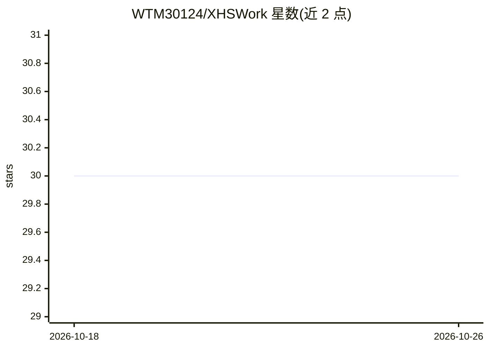

# WTM30124/XHSWork

⭐ 30 · TypeScript · 推送 2026-03-28 · [GitHub](https://github.com/WTM30124/XHSWork) · [官网](https://www.xhswork.com/) · 个人维护 · 中文 README

**面向小红书创作者的 AI 图文生成 SaaS 平台（可自部署）**

面向小红书内容创作者的全栈 Web 平台：一键生成图文（大纲→逐页编辑→批量配图）、文生图/图生图封面、爆款笔记链接解析与仿写、Plate.js 富文本 AI 编辑器、6 类违禁词检测、扫码发布。含积分/套餐/支付（支付宝、微信支付 V3）与完整管理后台，后台可配置多个兼容 OpenAI SDK 格式的模型服务（豆包、DeepSeek、通义千问、OpenAI、Claude）并按套餐轮询。技术栈为 Express 5 + MySQL 8 + React 19，需自行部署后端、前端与数据库。

## 筛选速览

| 维度 | 判定 | 备注 |
|---|---|---|
| AI 角色 | `ai-native` | 本体是模型或模型工具 |
| 许可风险 | `none` | — |
| 部署形态 | `library` | 以包/库形式分发 |
| 模型依赖 | — | README 未给出锁定关系 |
| 硬件要求 | — | 无带数字的原话,不猜 |
| 安装摩擦 | `low` | 无编译、无系统依赖或容器化 |
| 成熟度 | — | 结构信号不足 |

## 能力要点

- 一键图文生成：大纲→逐页编辑→批量生成配图
- 爆款复刻：解析笔记链接后仿写文案与复刻图片风格
- 后台可配置多个 OpenAI SDK 兼容模型并按套餐轮询负载均衡
- 内置 6 大分类违禁词库检测与替换建议

## 适用场景

- 我需要快速生成小红书图文笔记和封面
- 我想仿写爆款笔记并复刻其风格
- 我想搭建一个带积分和支付的内容创作 SaaS 站点

## 场景标签

`AI 写作` `图像生成` · 领域:内容生成

## 证据(README 行号)

> L11: - **一键图文生成** — 输入主题，AI 自动生成大纲 → 逐页编辑调整 → 批量生成配图，一句话完成完整图文创作
> L3: 基于 AI 的小红书内容创作工具，支持一键生成图文、AI 封面设计、爆款笔记仿写、智能编辑器等功能。

## 星数曲线

2026-10-18 30 → 2026-10-26 30（+0）

---
*卡片 v1 · prompt 1.4 · 生成 2026-10-26 · 置信度 high · 依据 README sha `b9c46b268757` · [字段定义](../../DATASET.md)*
