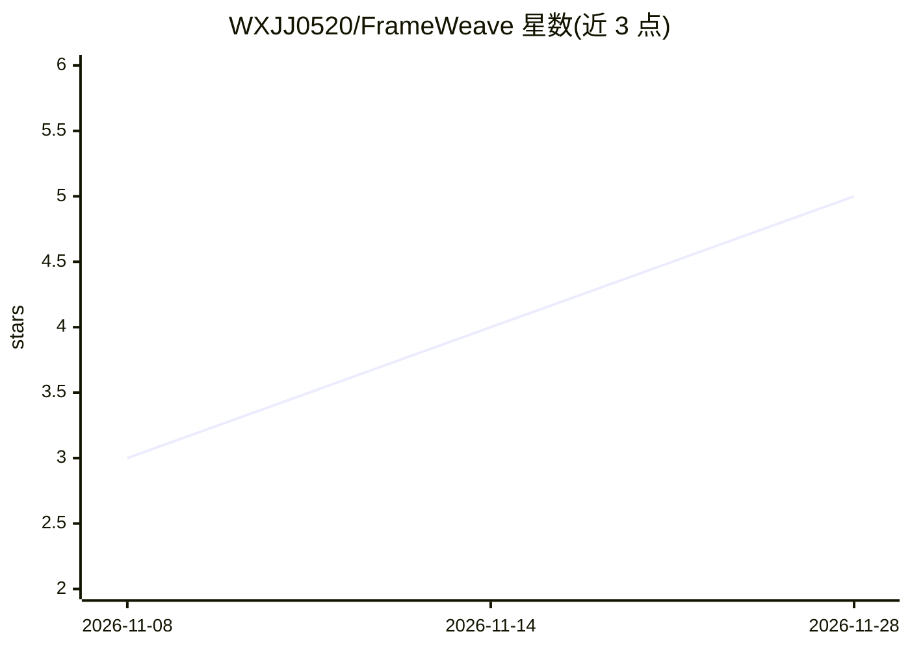

# WXJJ0520/FrameWeave

⭐ 5 · Python · Apache-2.0 · 推送 2026-10-22 · [GitHub](https://github.com/WXJJ0520/FrameWeave) · 个人维护 · 中文 README

**面向内容创作者的本地 AI 视频创作工作台**

基于 Python 后端与 React 工作台的本地视频创作应用，提供主题生成、数字人口播、图生视频、自定义素材编排、动作迁移五种创作方式，支持 5/8/10 分钟长视频的章节规划、逐镜头生成与合成。文本走 OpenAI 兼容 API，图片/视频接入 DashScope、ARK、Kling、Grok 等服务，配音用 Edge TTS，模板渲染与成片合成在本机完成，默认监听 127.0.0.1 面向单用户。依赖 Python 3.11+、uv、Node 22、FFmpeg 与 Playwright Chromium。

## 筛选速览

| 维度 | 判定 | 备注 |
|---|---|---|
| AI 角色 | `ai-native` | 本体是模型或模型工具 |
| 许可风险 | `permissive` | Apache-2.0 |
| 部署形态 | `None` |  |
| 模型依赖 | locked-api |  |
| 硬件要求 | — | 无带数字的原话,不猜 |
| 安装摩擦 | `medium` | 含编译或系统依赖之一 |
| 成熟度 | — | 结构信号不足 |

## 能力要点

- 五种创作方式统一工作台，三步流程贯穿
- 长视频编排：章节规划、逐镜头旁白与画面生成
- 支持 DashScope/ARK/Kling/Grok 等模型 API 的分组配置中心
- 中英双语界面，默认中文

## 适用场景

- 从一个主题生成知识讲解或教学视频
- 用实拍、录屏素材编排解说成片
- 人物图片加口播文案生成口播片段
- 让单张图片生成运动镜头素材

## 场景标签

`视频生成` `语音合成` · 领域:内容生成

## 证据(README 行号)

> L7: **镜织 FrameWeave** 是面向内容创作者、AI 教学博主和个人开发者的本地视频创作工作台。你可以从一个主题开始生成脚本与画面，也可以上传自己的图片、实拍或录屏素材，让 AI 辅助理解内容、组织旁白，再完成配音、模板排版、
> L215: 当前版本面向单用户本地使用，默认监听 `127.0.0.1`。模型服务通过 API 调用，模板渲染与成片合成在本机完成。Web 页面使用直接模型 API，不提供 RunningHub / ComfyUI 工作流入口。

## 星数曲线

2026-11-08 3 → 2026-11-28 5（+2）

---
*卡片 v1 · prompt 1.4 · 生成 2026-11-21 · 置信度 high · 依据 README sha `bbaad35b9b68` · [字段定义](../../DATASET.md)*
