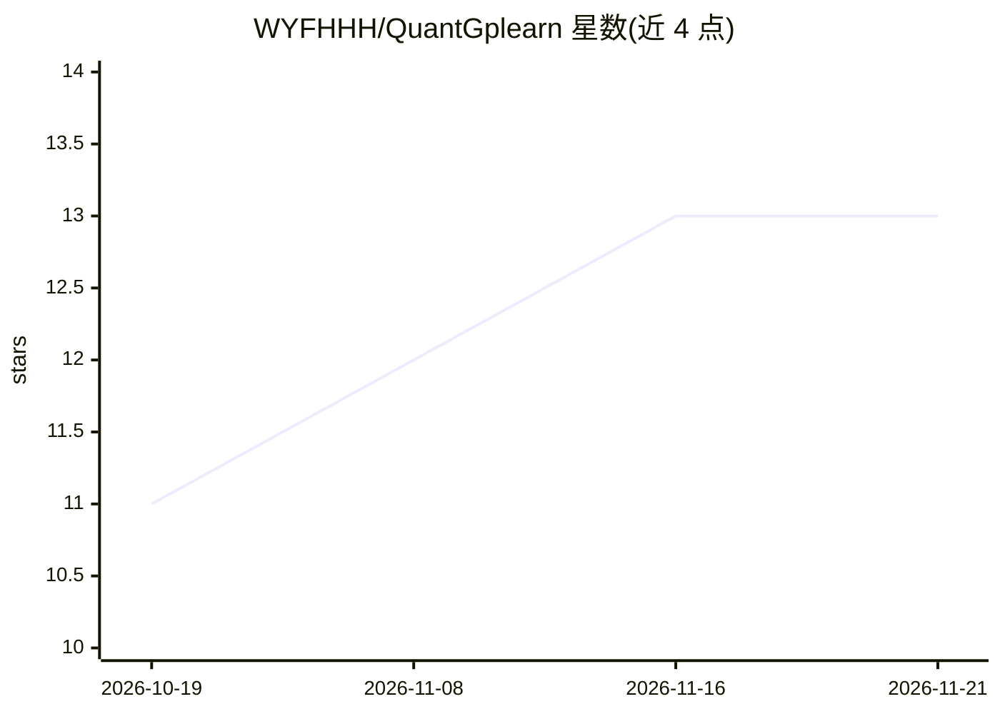

# WYFHHH/QuantGplearn

⭐ 13 · Python · MIT · 推送 2026-06-13 · [GitHub](https://github.com/WYFHHH/QuantGplearn) · 个人维护 · 中文 README

**量化研究员的遗传规划因子挖掘框架，产出可读公式**

面向量化因子研究的遗传规划框架：搜索由行情特征、时序算子与截面算子构成的可读符号表达式，而非黑盒权重。保留 NumPy/Pandas CPU 路径，并提供针对 [时间,标的,特征] 面板数据的 Torch/GPU 执行后端，支持 IC、RankIC、ICIR、多空 Sharpe 代理等研究目标，含因子相关性过滤、表达式导出与 alpha 池工具。文档列明 GPU 路径单设备串行、稠密面板内存开销等限制。安装方式为 git clone 后 pip install -e 源码安装，面向 Linux 上的 Python 3.11+。

## 筛选速览

| 维度 | 判定 | 备注 |
|---|---|---|
| AI 角色 | `ai-native` | 本体是模型或模型工具 |
| 许可风险 | `permissive` | MIT |
| 部署形态 | `library` | 以包/库形式分发 |
| 模型依赖 | — | README 未给出锁定关系 |
| 硬件要求 | `cpu-ok` | |
| 安装摩擦 | `medium` | 含编译或系统依赖之一 |
| 成熟度 | — | 结构信号不足 |

## 能力要点

- 进化出人类可读的符号因子表达式树
- 双执行后端：NumPy/Pandas CPU 与 Torch GPU 面板路径
- 49 个算子的 GPU 面板预设，含时序与截面算子
- IC/RankIC/ICIR/Sharpe 代理目标与因子相关性过滤

## 适用场景

- 从行情数据中挖掘可解释的量化因子公式
- 在 GPU 上批量评估稠密面板因子表达
- 增量构建经过相关性过滤的因子池
- 扩展自定义算子参与符号进化搜索

## 场景标签

`金融量化` · 领域:学习与行业

## 证据(README 行号)

> L20: QuantGplearn is a genetic-programming framework for quantitative factor
> L44: NumPy/Pandas CPU 路径，并提供适用于 `[时间, 标的, 特征]` 面板数据的 Torch/GPU
> L62: - `SymbolicRegressor` evolves formulas for continuous prediction.

## 星数曲线

2026-10-19 11 → 2026-11-21 13（+2）

---
*卡片 v1 · prompt 1.4 · 生成 2026-11-18 · 置信度 high · 依据 README sha `3edad9a50bdf` · [字段定义](../../DATASET.md)*
