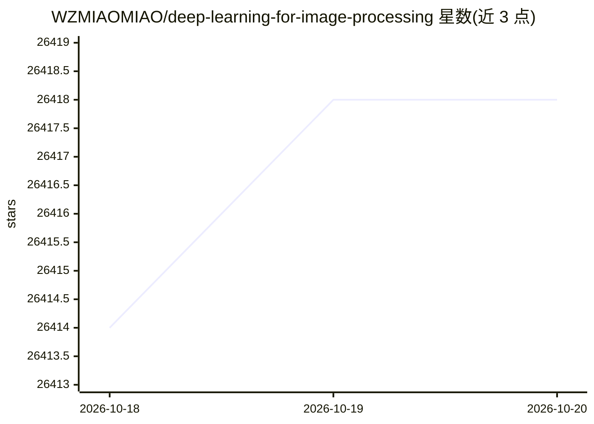

# WZMIAOMIAO/deep-learning-for-image-processing

⭐ 26,418 · Python · GPL-3.0 · 推送 2026-01-01 · [GitHub](https://github.com/WZMIAOMIAO/deep-learning-for-image-processing) · 个人维护 · 中文 README

**图像处理深度学习入门教程：讲解与代码实现经典网络**

作者整理研究生期间学习内容的教程项目，以视频课程形式在 bilibili 分享。内容覆盖图像分类（LeNet 至 ConvNeXt/MobileViT）、目标检测（Faster-RCNN、SSD、YOLO 系列等）、语义分割（FCN、DeepLabV3、U-Net 等）、实例分割、关键点检测。每个网络按“结构与创新点讲解→PyTorch 搭建→TensorFlow2 搭建”三段式教学，配套 PPT 放在 course_ppt 文件夹供下载，各模型源码以目录形式组织在仓库中。

## 筛选速览

| 维度 | 判定 | 备注 |
|---|---|---|
| AI 角色 | `ai-knowledge` | 知识聚合/清单类 |
| 许可风险 | `viral` | GPL-3.0 |
| 部署形态 | `None` |  |
| 模型依赖 | — | README 未给出锁定关系 |
| 硬件要求 | — | 无带数字的原话,不猜 |
| 安装摩擦 | `low` | 无编译、无系统依赖或容器化 |
| 成熟度 | — | 结构信号不足 |

## 动量与使用信号

- 维护:`declining` — 距上次 push 290.0 天,年发版 0,2 位贡献者
- 涨星:近 1 天 **+1**(自 20261016 起算)

## 能力要点

- 每个网络提供 PyTorch 与 TensorFlow2 双框架实现
- 覆盖分类、检测、分割、关键点检测四大任务方向
- 配套 bilibili 视频教程与可下载的课程 PPT
- 涵盖 LeNet 到 Swin Transformer、ConvNeXt 等多代网络

## 适用场景

- 跟着视频入门图像分类与目标检测的网络结构
- 对照源码学习用 PyTorch 或 TensorFlow2 搭建经典网络
- 下载 PPT 辅助复习深度学习课程知识点

## 场景标签

`教程课程` · 领域:学习与行业

## 证据(README 行号)

> L1: # 深度学习在图像处理中的应用教程
> L7: 2）使用Pytorch进行网络的搭建与训练
> L13: * 图像分类

## 星数曲线

2026-10-18 26,414 → 2026-10-20 26,418（+4）

---
*卡片 v1 · prompt 1.4 · 生成 2026-10-18 · 置信度 high · 依据 README sha `5b5760178810` · [字段定义](../../DATASET.md)*
