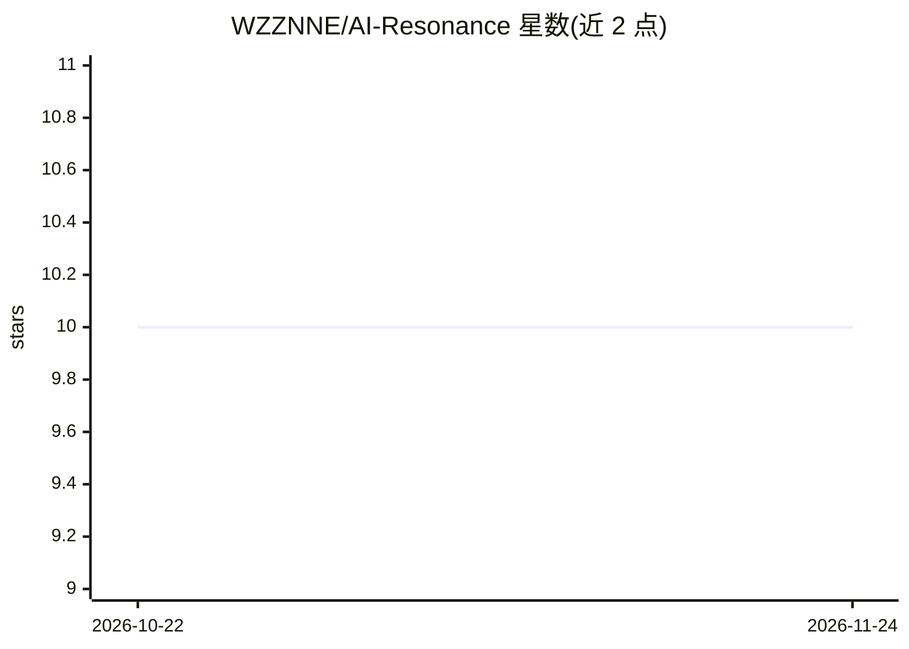

# WZZNNE/AI-Resonance

⭐ 10 · TypeScript · MIT · 推送 2026-11-24 · [GitHub](https://github.com/WZZNNE/AI-Resonance) · [官网](https://wzznne.github.io/AI-Resonance/) · 个人维护 · 中文 README

**每日 AI 资讯雷达：五大榜单聚合，评分可审计**

运行于 GitHub Actions 与 Pages 的无后端 AI 资讯聚合站点：每日从 GitHub、arXiv、Hacker News、X/Reddit 与 AI 实验室官方更新五个榜单各取前十，排序公式（信号、权重、上限）公开于 config.yaml，可逐项查看分数构成；跨源出现同一实体时聚成共振簇。条目保留 183 天历史、周报与浏览器内离线归档检索。LLM 仅生成简介与阅读判断（用户自带 key，浏览器内运行），不参与排名。提供 MCP server、静态 JSON API、Atom 订阅、邮件推送与单文件报告导出。

## 筛选速览

| 维度 | 判定 | 备注 |
|---|---|---|
| AI 角色 | `ai-enhanced` | 去掉 AI 部分产品仍成立 |
| 许可风险 | `permissive` | MIT |
| 部署形态 | `library` | 以包/库形式分发 |
| 模型依赖 | local-ok | 支持本地模型 |
| 硬件要求 | — | 无带数字的原话,不猜 |
| 安装摩擦 | `low` | 无编译、无系统依赖或容器化 |
| 成熟度 | — | 结构信号不足 |

## 能力要点

- 五榜单 × 每日十条，评分信号与权重公开于 config.yaml，可逐项审计
- 跨源实体共振聚类，echo 只作为可见信号进入评分
- 183 天条目历史：NEW/▲/▼/BACK 徽章、在榜天数与走势图
- BYOK 模型管理器支持十余家预设及任意 OpenAI/Anthropic 兼容端点

## 适用场景

- 每天用一份可审计的榜单跟踪 AI 领域动态
- 识别同一项目在多平台的跨源热度共振
- 本地部署一份自定义来源与主题的 AI 日报

## 场景标签

`精选清单` · 领域:学习与行业

## 证据(README 行号)

> L40:  `config.yaml`. Tap any score bar to see raw value, normalised value and points. An LLM may write a blurb. It
> L48: It runs entirely on GitHub Actions and GitHub Pages. There is no backend, database or account. Daily explanations c
> L58: Reading, Atom subscriptions, follow controls, bookmarks and reading-library backup need no key or account. A site o

## 星数曲线

2026-10-22 10 → 2026-11-24 10（+0）

---
*卡片 v1 · prompt 1.4 · 生成 2026-11-20 · 置信度 high · 依据 README sha `488d59a711b6` · [字段定义](../../DATASET.md)*
