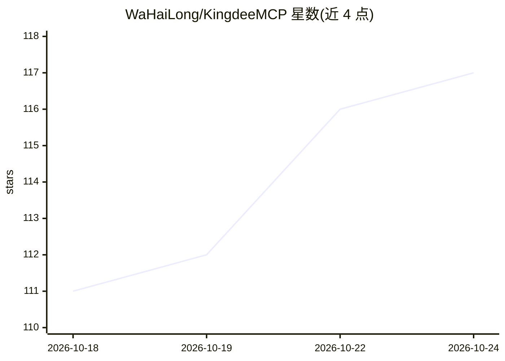

# WaHaiLong/KingdeeMCP

⭐ 117 · Python · MIT · 推送 2026-08-11 · [GitHub](https://github.com/WaHaiLong/KingdeeMCP) · [官网](https://wahailong.github.io/KingdeeMCP/) · 个人维护 · 中文 README

**让 AI 助手用自然语言操作金蝶云星空 ERP 的 MCP 服务端**

第三方开源的金蝶云星空 ERP MCP Server（非金蝶官方），基于 FastMCP 框架，向 Claude Desktop、Cursor、Windsurf、Cline 等 MCP 客户端暴露 87 个工具，覆盖采购、销售、库存、生产、成本、财务报表等 13+ 业务域的单据查询、新建、提交、审核、下推操作。认证采用金蝶官方 WebAPI 账号密码（ValidateUser）登录，兼容公有云与私有云；0.2.0 起从 AppID/AppSecret 改为账号密码，旧环境变量失效。附带元数据探查与可选的 SQL Server 表结构探查工具，支持 stdio/SSE/Streamable HTTP 三种传输模式。通过 pip 或 uvx 安装。

## 筛选速览

| 维度 | 判定 | 备注 |
|---|---|---|
| AI 角色 | `ai-ecosystem` | LLM/agent 周边工具 |
| 许可风险 | `permissive` | MIT |
| 部署形态 | `library` | 以包/库形式分发 |
| 模型依赖 | locked-api |  |
| 硬件要求 | — | 无带数字的原话,不猜 |
| 安装摩擦 | `low` | 无编译、无系统依赖或容器化 |
| 成熟度 | — | 结构信号不足 |

## 能力要点

- 87 个工具覆盖 13+ 业务域的单据查询与操作
- 基于金蝶官方 WebAPI ValidateUser 账号密码认证，兼容公有云/私有云
- 支持 stdio / SSE / Streamable HTTP 三种传输模式，可远程部署
- 内置元数据动态查询与可选的 SQL Server 表结构探查工具

## 适用场景

- 对 Claude/Cursor 等 AI 助手说一句话即完成 ERP 查询、下单、审核
- 实施人员用自然语言快速验证配置、批量核查单据与库存
- 开发人员探索金蝶表单结构与接口，替代翻文档调试
- 通过微信/WhatsApp/Telegram 中的 OpenClaw 远程操作金蝶

## 场景标签

 · 领域:企业软件/ERP 集成

## 证据(README 行号)

> L11: **Kingdee MCP Server** 是金蝶云星空（Kingdee Cloud Star）ERP 的 MCP（Model Context Protocol） 服务端，让 Claude、Cursor、Windsurf、Cli
> L58: - **87 个工具**：覆盖生产、成本、资产、审计、采购、销售、库存、财务报表等 13+ 大业务域

## 星数曲线

2026-10-18 111 → 2026-10-24 117（+6）

---
*卡片 v1 · prompt 1.4 · 生成 2026-10-23 · 置信度 high · 依据 README sha `fee2f5b3c1fd` · [字段定义](../../DATASET.md)*
