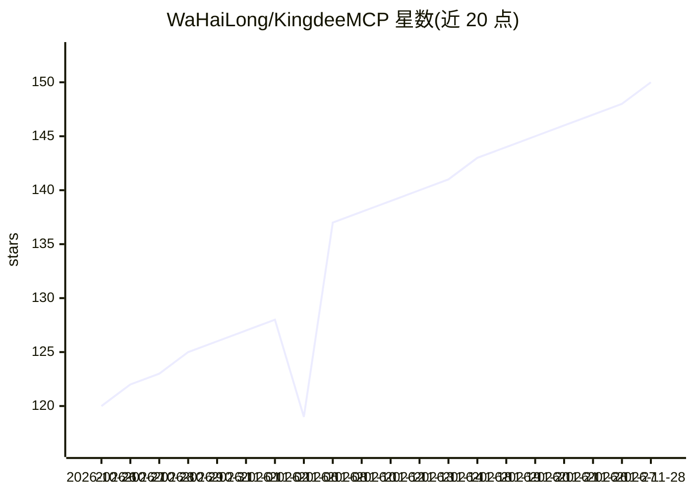

# WaHaiLong/KingdeeMCP

⭐ 150 · Python · MIT · 推送 2026-11-18 · [GitHub](https://github.com/WaHaiLong/KingdeeMCP) · [官网](https://wahailong.github.io/KingdeeMCP/) · 个人维护 · 中文 README

**金蝶云星空 ERP 的 MCP 服务端，AI 助手自然语言操作 ERP**

面向金蝶云星空 ERP 的 MCP 服务端，通过账号密码（ValidateUser）认证连接公有云或私有云，提供 101 个工具覆盖 17 个业务域（采购、销售、库存、生产、成本、固定资产、审计、附件、财务报表等），支持元数据动态查询与本地缓存、可选的 SQL Server 表结构探查，以及基于 FastMCP 的自定义工具扩展。供使用 Claude Desktop、Cursor、Windsurf、Cline 等 MCP 兼容客户端的企业实施人员、业务人员和开发者接入。支持 stdio/SSE/Streamable HTTP 三种传输方式与 Docker 部署。

## 筛选速览

| 维度 | 判定 | 备注 |
|---|---|---|
| AI 角色 | `ai-ecosystem` | LLM/agent 周边工具 |
| 许可风险 | `permissive` | MIT |
| 部署形态 | `self-host` | docker 或自建部署 |
| 模型依赖 | — | README 未给出锁定关系 |
| 硬件要求 | — | 无带数字的原话,不猜 |
| 安装摩擦 | `low` | 无编译、无系统依赖或容器化 |
| 成熟度 | — | 结构信号不足 |

## 能力要点

- 101 个工具覆盖 17 个业务域的单据查询、新建、提交、审核、下推等操作
- 支持 Claude Desktop、Cursor、Windsurf、Cline、OpenClaw 等 MCP 客户端
- 提供 stdio/SSE/Streamable HTTP 三种传输模式与 Docker 部署
- 元数据动态查询与本地缓存，附带 4 个 SQL Server 探查工具（可选配置）

## 适用场景

- 实施阶段用自然语言快速查询和核查金蝶单据数据
- 业务人员在聊天客户端里自助查询库存、订单、收款单
- 通过微信/WhatsApp/Telegram 借助 OpenClaw 操作金蝶
- 批量提交、审核单据，替代重复手工操作

## 场景标签

`工作流自动化` · 领域:效率与自动化

## 证据(README 行号)

> L11: **Kingdee MCP Server** 是金蝶云星空（Kingdee Cloud Star）ERP 的 MCP（Model Context Protocol） 服务端，让 Claude、Cursor、Windsurf、Cli
> L58: - **101 个工具**：覆盖生产、成本、资产、审计、采购、销售、库存、单据附件、财务、委外加工、财务报表等 17 大业务域
> L66: - **易于扩展**：基于 FastMCP 框架，轻松添加自定义工具

## 星数曲线

2026-10-26 120 → 2026-11-28 150（+30）

---
*卡片 v1 · prompt 1.4 · 生成 2026-11-27 · 置信度 high · 依据 README sha `cbb4982af8c9` · [字段定义](../../DATASET.md)*
