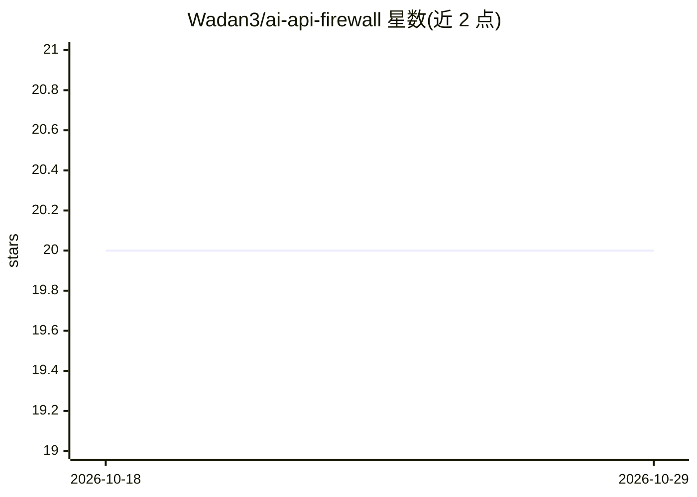

# Wadan3/ai-api-firewall

⭐ 20 · Python · MIT · 推送 2026-06-07 · [GitHub](https://github.com/Wadan3/ai-api-firewall) · 个人维护

**机器学习 API 网关：实时检测并拦截恶意 Web 流量**

基于 FastAPI 的反向代理型 API 网关，使用 Isolation Forest 无监督学习算法分析进入的 HTTP 请求，检测异常（如超长路径、过多特殊字符）并拦截恶意流量，无需显式攻击签名。附带生成合成 API 日志并即时训练模型的数据管道脚本。技术栈为 Python 3.x、FastAPI、Uvicorn、Scikit-Learn/Pandas/Numpy，通过克隆源码仓库方式获取。

## 筛选速览

| 维度 | 判定 | 备注 |
|---|---|---|
| AI 角色 | `ai-native` | 本体是模型或模型工具 |
| 许可风险 | `permissive` | MIT |
| 部署形态 | `None` |  |
| 模型依赖 | — | README 未给出锁定关系 |
| 硬件要求 | — | 无带数字的原话,不猜 |
| 安装摩擦 | `low` | 无编译、无系统依赖或容器化 |
| 成熟度 | — | 结构信号不足 |

## 能力要点

- Isolation Forest 无监督异常检测，无需攻击签名
- 毫秒级实时分析进入的 HTTP 请求
- 含合成 API 日志生成与模型即时训练脚本
- FastAPI 实现的轻量反向代理

## 适用场景

- 在 API 前置一层检测并拦截恶意流量
- 识别无已知签名的异常请求与零日攻击模式
- 生成合成日志快速训练与测试检测模型

## 场景标签

`网络安全` · 领域:学习与行业

## 证据(README 行号)

> L3: An intelligent, machine-learning-powered API Gateway designed to detect and block malicious web traffic in real-time
> L7: * **Unsupervised Machine Learning:** Uses the `Isolation Forest` algorithm to detect anomalies (e.g., extremely long

## 星数曲线

2026-10-18 20 → 2026-10-29 20（+0）

---
*卡片 v1 · prompt 1.4 · 生成 2026-10-28 · 置信度 high · 依据 README sha `39ae02e6a45d` · [字段定义](../../DATASET.md)*
